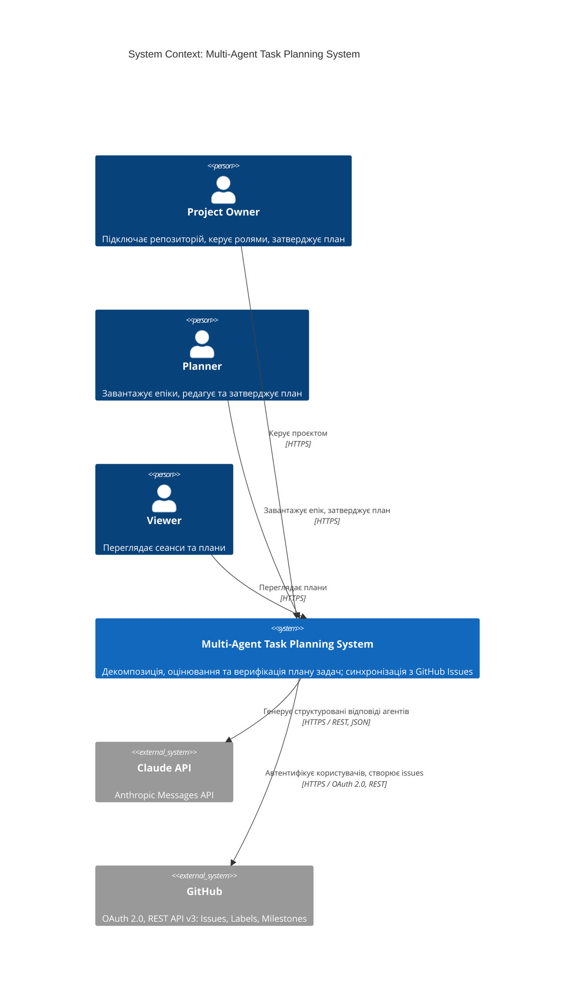
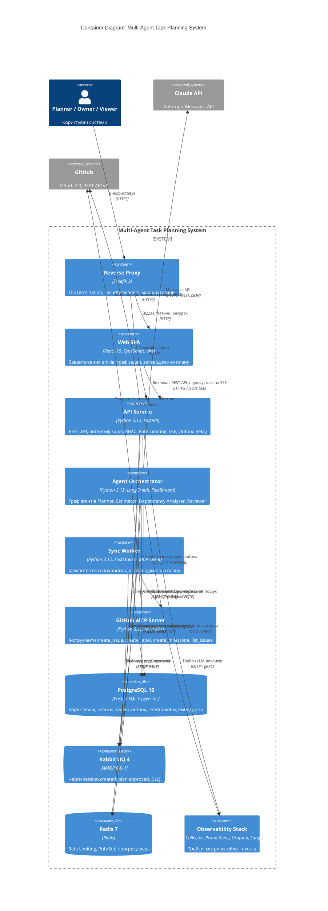
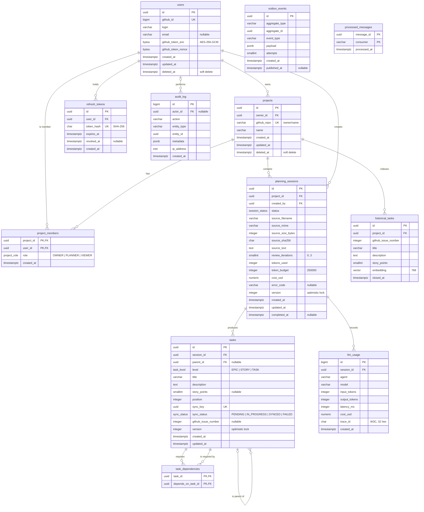
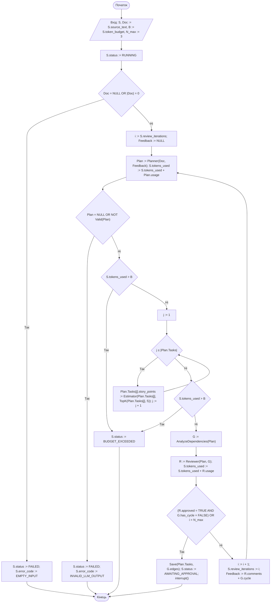
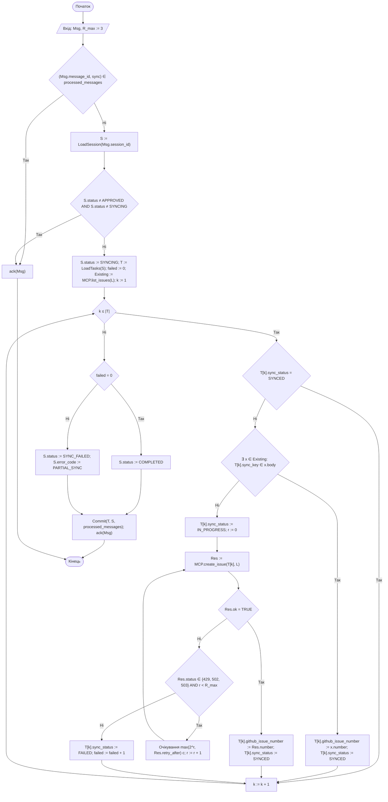

# РОЗДІЛ 2. ОБҐРУНТУВАННЯ АРХІТЕКТУРНИХ РІШЕНЬ ТА ПРОЄКТУВАННЯ СИСТЕМИ

Архітектура описана за методологією C4 Model (Simon Brown) у форматі Diagrams-as-Code (Mermaid.js).
Вимоги, на які посилаються описи, зафіксовано у [SRS](./srs.md); архітектурні рішення — у
каталозі [adr/](./adr/).

## 2.1. Обґрунтування архітектурного стилю та патернів проєктування

### 2.1.1. Глобальний архітектурний стиль

Для системи обрано **подієво-орієнтовану архітектуру з модульними сервісами**: чотири
прикладні контейнери (API Service, Agent Orchestrator, Sync Worker, GitHub MCP Server), що
взаємодіють через брокер повідомлень RabbitMQ і спільну БД PostgreSQL з розмежуванням прав
доступу на рівні таблиць ([C4 Level 2](#діаграма-рівня-2-container)).

Вибір визначено розбіжністю часових характеристик операцій. Синхронні ендпоінти мають
відповідати за p95 ≤ 200 мс ([SRS-NFR-PERF-01](./srs.md#srs-nfr-perf-01)), тоді як сеанс
планування містить від 6 до 15 послідовних викликів LLM і триває до 180 с
([SRS-NFR-PERF-03](./srs.md#srs-nfr-perf-03)). Виконання сеансу в процесі обробки HTTP-запиту
утримувало б з'єднання та worker-процес ASGI-сервера на весь час генерації: при 20 паралельних
сеансах ([SRS-NFR-SCAL-01](./srs.md#srs-nfr-scal-01)) пул worker-ів API Service вичерпувався б
запитами, що очікують LLM, і час відповіді коротких запитів зростав би пропорційно черзі.
Винесення сеансу в асинхронний контур розриває цю залежність: API Service лише записує сеанс і
подію в одній транзакції та повертає 202 Accepted ([SRS-NFR-PERF-02](./srs.md#srs-nfr-perf-02)).

Розмежування контейнерів виконано за профілем навантаження та межею відмови, а не за
сутностями предметної області:

| Контейнер | Профіль навантаження | Межа відмови |
| --- | --- | --- |
| API Service | Короткі запити, CPU на валідацію JWT і серіалізацію | Відмова LLM або GitHub не впливає на автентифікацію та читання планів |
| Agent Orchestrator | Тривалі I/O-bound операції (очікування LLM) | Збій процесу відновлюється з checkpoint; масштабується кількістю реплік |
| Sync Worker | Пакетні виклики GitHub API з обмеженням швидкості | Недоступність GitHub не блокує планування нових сеансів |
| GitHub MCP Server | Ізольований доступ до зовнішнього API | Набір операцій обмежено білим списком інструментів ([SRS-NFR-SEC-04](./srs.md#srs-nfr-sec-04)) |

**Відмова від дрібнозернистих мікросервісів.** Предметна область містить один обмежений
контекст (планування задач). Поділ на сервіси «користувачі», «проєкти», «сеанси», «задачі» з
окремими БД вимагав би розподілених транзакцій для операцій, що змінюють сеанс і задачі
одночасно (затвердження плану), і не скорочував би затримку. Спільна БД є свідомим
компромісом (Shared Database). Ризик неконтрольованої зв'язності за схемою обмежується:
власником схеми та міграцій (Alembic) є API Service; кожен контейнер підключається окремою
роллю PostgreSQL з правами лише на свої таблиці (Agent Orchestrator — запис у `tasks`,
`task_dependencies`, `llm_usage`, схему `langgraph`; Sync Worker — оновлення
`tasks.sync_status`, `tasks.github_issue_number`, статусу сеансу).

**Відмова від модульного моноліту.** Моноліт з фоновими задачами в тому самому процесі
усуває мережеву взаємодію, але поєднує в одній одиниці масштабування короткі запити й тривалі
сеанси та не дозволяє ізолювати облікові дані GitHub від процесу, що обробляє вміст
користувацьких документів, переданий у LLM.

**Каскадні збої.** Між прикладними контейнерами немає синхронних викликів, окрім
Sync Worker → GitHub MCP Server; на цьому зв'язку та на зовнішніх викликах Claude API і GitHub
API застосовано Circuit Breaker і Retry with Exponential Backoff
([SRS-NFR-REL-02](./srs.md#srs-nfr-rel-02)). Відмова Claude API переводить у стан `FAILED` лише
сеанси, що виконуються, і не впливає на API Service; відмова GitHub — лише синхронізацію.

**Single Point of Failure.** PostgreSQL і RabbitMQ розгорнуто в одному екземплярі
(обмеження Docker Compose на одному хості). Ризик прийнято в межах SLO 99.5 %
([SRS-NFR-REL-01](./srs.md#srs-nfr-rel-01)) і компенсується: щоденним резервним копіюванням
([SRS-NFR-REL-05](./srs.md#srs-nfr-rel-05)); durable-чергами з persistent-повідомленнями та
publisher confirms; Transactional Outbox, що зберігає неопубліковані події в БД на час
недоступності брокера; політикою `restart: unless-stopped` і healthcheck для всіх контейнерів.

**FinOps.** Основна змінна вартість — токени LLM. Вартість одного сеансу обмежено бюджетом
250 000 токенів ([SRS-NFR-COST-01](./srs.md#srs-nfr-cost-01)) та лімітом трьох ітерацій
верифікації. Допоміжні операції (класифікація, нормалізація заголовків) виконуються моделлю
Claude Haiku; Claude Sonnet використовується лише вузлами Planner і Reviewer.

### 2.1.2. Патерни мікрорівня

| Патерн | Місце застосування | Проблема, що вирішується |
| --- | --- | --- |
| Ports & Adapters (Clean Architecture) | Agent Orchestrator, API Service | Вузли графа залежать від `LLMPort`, а не від SDK; тестування без звернення до Claude API ([2.3](#23-компонентне-моделювання-та-опис-серверного-ядра)) |
| Dependency Injection | Збирання адаптерів під час старту процесу; `Depends` у FastAPI | Заміна реалізацій (mock LLM, testcontainers) без зміни коду вузлів |
| Repository + Unit of Work | SQLAlchemy `AsyncSession` | Зміна статусу сеансу та запис події в outbox фіксуються однією транзакцією |
| Transactional Outbox | API Service → RabbitMQ | Усуває розбіжність «дані збережено, подію втрачено» без двофазного коміту |
| Idempotent Consumer | Orchestrator, Sync Worker | RabbitMQ гарантує доставку at-least-once; повторна доставка не створює дублікатів ([SRS-NFR-REL-04](./srs.md#srs-nfr-rel-04)) |
| State Machine | Статус сеансу | Дозволені переходи перевіряються в одному місці, недопустимі — відхиляються з HTTP 409 |
| Strategy | Реалізації `LLMPort` (Sonnet, Haiku, Mock) | Вибір моделі для вузла задається конфігурацією |
| Observer | Callback використання токенів → BudgetGuard, Telemetry | Облік вартості без зв'язування вузлів графа з механізмом обліку |
| Circuit Breaker, Retry | ClaudeAdapter, MCP-клієнт Sync Worker | Обмеження каскадних збоїв і навантаження на зовнішній API під час деградації |
| Optimistic Locking | `version` у `planning_sessions`, `tasks` | Конкурентне редагування плану кількома користувачами без блокувань рядків на час редагування |

#### Допустимі переходи статусу сеансу

| Поточний статус | Допустимі наступні статуси | Ініціатор |
| --- | --- | --- |
| `QUEUED` | `RUNNING` | Agent Orchestrator |
| `RUNNING` | `AWAITING_APPROVAL`, `FAILED`, `BUDGET_EXCEEDED` | Agent Orchestrator |
| `AWAITING_APPROVAL` | `APPROVED`, `REJECTED` | API Service (рішення користувача) |
| `APPROVED` | `SYNCING` | Sync Worker |
| `SYNCING` | `COMPLETED`, `SYNC_FAILED` | Sync Worker |

**Відхилені патерни.** CQRS не застосовано: співвідношення операцій читання та запису
однорідне, окрема модель читання не скорочує затримку за обсягу до 60 задач на сеанс і
подвоює кількість моделей, що підлягають синхронізації. Saga не застосовано: процес містить
одну зовнішню операцію з побічним ефектом (створення issues), яка не потребує компенсації —
часткова синхронізація фіксується статусом `SYNC_FAILED`, а повторна обробка ідемпотентна за
`sync_key` ([2.8.3](#283-алгоритм-ідемпотентної-синхронізації-плану-з-github-issues)).

### 2.1.3. Зафіксовані архітектурні рішення

| ID | Рішення | Статус |
| --- | --- | --- |
| [ADR-001](./adr/0001-agent-orchestration-framework.md) | Вибір фреймворку оркестрування агентів: LangGraph | Approved |

## 2.2. Контекстне та контейнерне моделювання системи

### Діаграма рівня 1: System Context

**Опис елементів.**

| Елемент | Тип | Опис | Вимоги |
| --- | --- | --- | --- |
| Project Owner, Planner, Viewer | Person | Ролі моделі RBAC | [SRS-FUN-03](./srs.md#srs-fun-03) |
| Multi-Agent Task Planning System | System | Програмна система, що розробляється | [SRS §1.1](./srs.md#11-призначення-та-межі-системи-scope) |
| Claude API | System_Ext | Зовнішня LLM; виклики через HTTPS з ключем API | [SRS-FUN-07](./srs.md#srs-fun-07) — [SRS-FUN-10](./srs.md#srs-fun-10) |
| GitHub | System_Ext | Identity Provider (OAuth 2.0) та цільовий трекер задач | [SRS-FUN-01](./srs.md#srs-fun-01), [SRS-FUN-13](./srs.md#srs-fun-13) |

### Діаграма рівня 2: Container

**Опис контейнерів.**

| Контейнер | Відповідальність | Вимоги | Рішення |
| --- | --- | --- | --- |
| Reverse Proxy | TLS termination, HSTS, CSP, маршрутизація SPA та API | [SRS-NFR-SEC-05](./srs.md#srs-nfr-sec-05) | — |
| Web SPA | Інтерфейс завантаження, перегляду графа задач та затвердження | [SRS-FUN-06](./srs.md#srs-fun-06), [SRS-FUN-11](./srs.md#srs-fun-11) | — |
| API Service | Автентифікація, RBAC, прийом файлів, створення сеансів, Rate Limiting, SSE, Outbox Relay | [SRS-FUN-01](./srs.md#srs-fun-01) — [SRS-FUN-06](./srs.md#srs-fun-06), [SRS-FUN-17](./srs.md#srs-fun-17), [SRS-NFR-SEC-03](./srs.md#srs-nfr-sec-03) | — |
| Agent Orchestrator | Виконання графа агентів, checkpointing, контроль бюджету | [SRS-FUN-07](./srs.md#srs-fun-07) — [SRS-FUN-12](./srs.md#srs-fun-12), [SRS-FUN-15](./srs.md#srs-fun-15), [SRS-FUN-16](./srs.md#srs-fun-16) | [ADR-001](./adr/0001-agent-orchestration-framework.md) |
| Sync Worker | Ідемпотентна синхронізація плану з GitHub | [SRS-FUN-13](./srs.md#srs-fun-13), [SRS-FUN-14](./srs.md#srs-fun-14), [SRS-NFR-REL-04](./srs.md#srs-nfr-rel-04) | — |
| GitHub MCP Server | Ізоляція доступу до GitHub API, білий список інструментів | [SRS-NFR-SEC-04](./srs.md#srs-nfr-sec-04) | — |
| PostgreSQL 16 + pgvector | Основне сховище, checkpoint-и, outbox, векторний пошук | [SRS-FUN-08](./srs.md#srs-fun-08), [SRS-NFR-REL-05](./srs.md#srs-nfr-rel-05) | — |
| RabbitMQ 4 | Асинхронна доставка подій, competing consumers, DLQ | [SRS-NFR-SCAL-01](./srs.md#srs-nfr-scal-01), [SRS-NFR-REL-04](./srs.md#srs-nfr-rel-04) | — |
| Redis 7 | Token Bucket, Pub/Sub прогресу | [SRS-NFR-SEC-03](./srs.md#srs-nfr-sec-03), [SRS-NFR-PERF-04](./srs.md#srs-nfr-perf-04) | — |
| Observability Stack | Трейси, метрики RED, облік токенів і вартості | [SRS-NFR-OBS-01](./srs.md#srs-nfr-obs-01), [SRS-FUN-15](./srs.md#srs-fun-15) | — |

**Протоколи взаємодії.** Синхронна взаємодія клієнта із системою виконується через HTTPS (REST,
JSON) та Server-Sent Events. Тривалі операції (сеанси планування, синхронізація) винесено в
асинхронний контур через RabbitMQ (AMQP 0-9-1), що забезпечує відповідь API у межах
[SRS-NFR-PERF-02](./srs.md#srs-nfr-perf-02) незалежно від затримки LLM. Доступ до GitHub API
для запису виконується виключно через GitHub MCP Server (MCP, транспорт Streamable HTTP), що
обмежує набір операцій білим списком інструментів.

## 2.3. Компонентне моделювання та опис серверного ядра

Критичним сервісом обрано **Agent Orchestrator**: він містить основне обчислювальне навантаження,
усі виклики LLM та логіку відновлення сеансів.

### Діаграма рівня 3: Component (Agent Orchestrator)

```mermaid
C4Component
    title Component Diagram: Agent Orchestrator

    ContainerQueue(mq, "RabbitMQ", "AMQP 0-9-1")
    ContainerDb(pg, "PostgreSQL + pgvector", "SQL")
    ContainerDb(redis, "Redis", "Pub/Sub")
    System_Ext(claude, "Claude API", "HTTPS")

    Container_Boundary(orch, "Agent Orchestrator") {
        Component(consumer, "SessionEventConsumer", "FastStream subscriber", "Приймає session.created та plan.decision")
        Component(validator, "MessageValidator", "Pydantic v2 DTO", "Валідація схеми повідомлення")
        Component(idem, "IdempotencyGuard", "Middleware", "Відкидає повторно доставлені message_id")
        Component(errh, "ErrorHandler", "Middleware", "Класифікація помилок, nack у DLQ")
        Component(usecase, "RunPlanningSession", "Application Service", "Запуск та відновлення графа сеансу")
        Component(graph, "PlanningGraph", "LangGraph StateGraph", "Вузли та умовні переходи, interrupt")
        Component(planner, "PlannerNode", "Domain", "Декомпозиція Epic → Story → Task")
        Component(estimator, "EstimatorNode", "Domain", "Оцінка story points з RAG")
        Component(deps, "DependencyAnalyzer", "Domain, pure Python", "Цикли, топологічне сортування, критичний шлях")
        Component(reviewer, "ReviewerNode", "Domain", "Верифікація повноти, лічильник ітерацій")
        Component(budget, "BudgetGuard", "Domain Service", "Облік токенів, ліміт сеансу")
        Component(prompt, "PromptBuilder", "Domain Service", "Шаблони промптів, ізоляція вхідних даних")
        Component(llm, "ClaudeAdapter", "langchain-anthropic", "Реалізує LLMPort: retry, circuit breaker, structured output")
        Component(ckpt, "PostgresCheckpointer", "LangGraph PostgresSaver", "Реалізує CheckpointPort")
        Component(repo, "TaskRepository", "SQLAlchemy 2.0", "Реалізує TaskRepositoryPort")
        Component(vec, "SimilarTaskSearch", "pgvector, sentence-transformers", "Реалізує VectorSearchPort")
        Component(progress, "ProgressPublisher", "redis-py", "Реалізує ProgressPort")
        Component(tracer, "Telemetry", "OpenTelemetry SDK, Langfuse", "Трейси вузлів і LLM-викликів")
    }

    Rel(mq, consumer, "Доставляє повідомлення", "AMQP")
    Rel(consumer, validator, "Передає payload", "Middleware chain")
    Rel(validator, idem, "Валідний DTO", "Middleware chain")
    Rel(idem, usecase, "Викликає", "Interface call")
    Rel(errh, consumer, "Обгортає обробник", "Decorator")
    Rel(usecase, graph, "invoke / resume", "Interface call")
    Rel(graph, planner, "Вузол", "Graph edge")
    Rel(graph, estimator, "Вузол", "Graph edge")
    Rel(graph, deps, "Вузол", "Graph edge")
    Rel(graph, reviewer, "Вузол, умовний перехід", "Conditional edge")
    Rel(graph, ckpt, "Зберігає стан після вузла", "CheckpointPort (DI)")
    Rel(planner, prompt, "Формує промпт", "Interface call")
    Rel(planner, llm, "Structured output", "LLMPort (DI)")
    Rel(estimator, vec, "top-k = 5", "VectorSearchPort (DI)")
    Rel(estimator, llm, "Structured output", "LLMPort (DI)")
    Rel(reviewer, llm, "Structured output", "LLMPort (DI)")
    Rel(llm, budget, "Повідомляє usage", "Observer")
    Rel(usecase, repo, "Зберігає план", "TaskRepositoryPort (DI)")
    Rel(usecase, progress, "Подія прогресу", "ProgressPort (DI)")
    Rel(llm, claude, "Messages API", "HTTPS")
    Rel(ckpt, pg, "SQL", "TCP")
    Rel(repo, pg, "SQL", "TCP")
    Rel(vec, pg, "Векторний пошук", "SQL / TCP")
    Rel(progress, redis, "PUBLISH", "RESP")
    Rel(llm, tracer, "Span LLM-виклику", "Callback")

    UpdateLayoutConfig($c4ShapeInRow="4", $c4BoundaryInRow="1")
```

**Опис шарів та компонентів.**

| Шар | Компонент | Призначення | Вимоги |
| --- | --- | --- | --- |
| Inbound | SessionEventConsumer | Підписник черг `session.created` і `plan.decision`; ручне підтвердження (manual ack) після фіксації checkpoint | [SRS-FUN-05](./srs.md#srs-fun-05), [SRS-FUN-11](./srs.md#srs-fun-11) |
| Inbound | MessageValidator | Перевірка повідомлення за Pydantic-схемою; невалідні повідомлення спрямовуються в DLQ без повторів | [SRS-NFR-REL-04](./srs.md#srs-nfr-rel-04) |
| Inbound | IdempotencyGuard | Реєстрація `message_id` у PostgreSQL; повторна доставка не запускає граф удруге | [SRS-NFR-REL-04](./srs.md#srs-nfr-rel-04) |
| Inbound | ErrorHandler | Розділення помилок на transient (requeue з затримкою) та permanent (DLQ) | [SRS-NFR-REL-02](./srs.md#srs-nfr-rel-02) |
| Application | RunPlanningSession | Use case запуску та відновлення сеансу за `thread_id` | [SRS-FUN-12](./srs.md#srs-fun-12) |
| Core | PlanningGraph | Граф станів; умовний перехід Reviewer → Planner обмежено лічильником ітерацій; interrupt перед завершенням | [SRS-FUN-10](./srs.md#srs-fun-10), [SRS-FUN-11](./srs.md#srs-fun-11) |
| Core | PlannerNode, EstimatorNode, ReviewerNode | Вузли агентів; залежать лише від портів | [SRS-FUN-07](./srs.md#srs-fun-07), [SRS-FUN-08](./srs.md#srs-fun-08), [SRS-FUN-10](./srs.md#srs-fun-10) |
| Core | DependencyAnalyzer | Детермінований аналіз графа без виклику LLM (алгоритм Кана, пошук циклів DFS, критичний шлях) | [SRS-FUN-09](./srs.md#srs-fun-09) |
| Core | BudgetGuard | Агрегація usage з відповідей LLM; перериває сеанс при перевищенні ліміту | [SRS-FUN-16](./srs.md#srs-fun-16), [SRS-NFR-COST-01](./srs.md#srs-nfr-cost-01) |
| Core | PromptBuilder | Розміщення вмісту документа в окремому блоці даних, відокремленому від інструкцій | [SRS-NFR-SEC-04](./srs.md#srs-nfr-sec-04) |
| Outbound | ClaudeAdapter | Реалізація `LLMPort`; retry з backoff та circuit breaker; `max_tokens` | [SRS-NFR-REL-02](./srs.md#srs-nfr-rel-02), [SRS-NFR-COST-02](./srs.md#srs-nfr-cost-02) |
| Outbound | PostgresCheckpointer | Збереження стану графа після кожного вузла | [SRS-NFR-REL-03](./srs.md#srs-nfr-rel-03) |
| Outbound | TaskRepository, SimilarTaskSearch | Доступ до задач і векторного індексу | [SRS-FUN-08](./srs.md#srs-fun-08) |
| Outbound | ProgressPublisher, Telemetry | Події прогресу, трейси та облік токенів | [SRS-FUN-06](./srs.md#srs-fun-06), [SRS-FUN-15](./srs.md#srs-fun-15), [SRS-NFR-OBS-01](./srs.md#srs-nfr-obs-01) |

**Правило залежностей.** Компоненти шару Core залежать лише від портів (`LLMPort`,
`CheckpointPort`, `TaskRepositoryPort`, `VectorSearchPort`, `ProgressPort`). Реалізації портів
впроваджуються під час старту процесу (Dependency Injection), що дозволяє тестувати вузли графа з
mock-реалізацією LLM і виконувати перевірки [SRS-FUN-10](./srs.md#srs-fun-10) без звернення до
Claude API. Вибір LangGraph як механізму оркестрування обґрунтовано в
[ADR-001](./adr/0001-agent-orchestration-framework.md).

### Опис взаємодії рівнів серверного ядра

Обробка повідомлення `session.created` проходить три рівні, кожен з яких має власну
відповідальність і не звертається до інфраструктури в обхід портів.

**Inbound Layer.** `SessionEventConsumer` отримує повідомлення з prefetch = 1 (одне
повідомлення на репліку одночасно) та в режимі manual ack. `ErrorHandler` обгортає обробник і
класифікує винятки: помилки валідації схеми та невідомі `session_id` вважаються permanent і
спрямовуються в DLQ без повторів; тайм-аути та HTTP 5xx зовнішніх API — transient і
повертаються в чергу із затримкою. `MessageValidator` перетворює тіло повідомлення на
Pydantic-модель зі `strict = True` та `extra = "forbid"`. `IdempotencyGuard` перевіряє
`processed_messages` і поточний статус сеансу: для `RUNNING` з наявним checkpoint виконується
відновлення, а не повторний запуск ([SRS-FUN-12](./srs.md#srs-fun-12)).

**Core Layer.** `RunPlanningSession` — єдина точка входу в доменну логіку: переводить сеанс у
`RUNNING` з перевіркою `version`, викликає `PlanningGraph` з `thread_id = session_id` і після
`interrupt()` фіксує план у БД. Вузли графа (Planner, Estimator, Reviewer) отримують залежності
лише через конструктор у вигляді портів; `DependencyAnalyzer` не має залежностей від I/O і
тестується як чиста функція. `BudgetGuard` отримує дані про використання токенів через
callback адаптера (Observer) і перериває граф винятком `BudgetExceeded`, який use case
перетворює на статус `BUDGET_EXCEEDED`. `PromptBuilder` формує запити з фіксованих шаблонів і
розміщує вміст документа в окремому блоці даних.

**Outbound Layer.** Адаптери реалізують порти та інкапсулюють механізми надійності:
`ClaudeAdapter` — retry, circuit breaker, `max_tokens`, structured output за JSON Schema;
`PostgresCheckpointer` — збереження стану після кожного вузла; `TaskRepository` — пакетну
вставку задач і залежностей в одній транзакції; `SimilarTaskSearch` — векторний пошук з
фільтром за `project_id`; `ProgressPublisher` — публікацію подій у канал Redis
`session:{id}`. Жоден компонент Core Layer не імпортує SQLAlchemy, redis-py або
langchain-anthropic, що перевіряється правилом import-linter у CI.

## 2.4. Контур безпеки програмного рішення (Application Security)

Контур безпеки побудовано за принципом багаторівневого захисту: кожен запит послідовно
проходить Reverse Proxy, ланцюг middleware API Service, перевірку прав на рівні об'єкта та
валідацію схеми, а дані, що передаються в LLM і GitHub, проходять окремі механізми ізоляції.

### 2.4.1. Ланцюг обробки запиту в API Service

| № | Компонент | Механізм | Відхилення |
| --- | --- | --- | --- |
| 1 | Traefik | TLS 1.2+ (TLS 1.3 пріоритетно), `maxRequestBodyBytes = 10 485 760` для `/sessions`, 1 МБ для інших шляхів | 413 до передачі запиту в застосунок |
| 2 | `SecurityHeadersMiddleware` (Traefik) | HSTS `max-age=31536000; includeSubDomains`, CSP `default-src 'self'`, `X-Content-Type-Options: nosniff`, `X-Frame-Options: DENY` | — |
| 3 | `CORSMiddleware` | Дозволено одне походження (домен SPA), `allow_credentials = true`, методи GET, POST, PATCH | Preflight 403 |
| 4 | `JWTAuthMiddleware` | PyJWT, RS256, перевірка `iss`, `aud`, `exp`, `nbf`, `kid`; список алгоритмів фіксований (захист від `alg: none` та підміни на HS256) | 401 + `WWW-Authenticate` |
| 5 | `RateLimitMiddleware` | Token Bucket у Redis (атомарний Lua-скрипт): 60 запитів/хв на користувача, 10 сеансів/год, 20 запитів/хв на IP для `/auth/*` | 429 + `Retry-After` |
| 6 | `ProjectAccessGuard` | Запит членства `project_members` за (`project_id`, `user_id`) для кожного звернення до проєкту або сеансу | 404 (ресурс поза доступом не розкривається) |
| 7 | `RoleGuard` | RBAC: створення сеансу, редагування та рішення — `OWNER`, `PLANNER`; читання — усі ролі | 403 |
| 8 | Pydantic DTO | `extra = "forbid"`, обмеження довжин і переліків з OpenAPI-контракту | 400 з переліком полів |
| 9 | `AuditLogger` | Запис подій безпеки в `audit_log` (лише INSERT) | — |

### 2.4.2. Автентифікація та керування сесіями

Автентифікація виконується через GitHub OAuth 2.0 Authorization Code Flow з PKCE (`S256`) і
параметром `state`, прив'язаним до cookie, що виключає CSRF на callback-ендпоінті. Паролі в
системі не зберігаються, тому хешування паролів (Argon2id, bcrypt) не застосовується.

Access JWT (RS256, ключ RSA 3072 біт, TTL 15 хв) зберігається лише в пам'яті SPA і не
записується в `localStorage`, що виключає його викрадення через XSS зі сховища браузера.
Refresh-токен — випадкове 256-бітне значення в cookie `HttpOnly; Secure; SameSite=Strict;
Path=/api/v1/auth`; у БД зберігається SHA-256 хеш. Для значення з 256 бітами ентропії
SHA-256 достатній: повільні функції хешування призначені для захисту низькоентропійних
паролів від перебору. Кожне використання refresh-токена ротує його; повторне пред'явлення
відкликаного токена відкликає всі токени користувача (reuse detection).

Ключі підпису JWT передаються через Docker secrets; заголовок `kid` дозволяє ротацію ключів
без інвалідації виданих токенів.

### 2.4.3. Захист від уразливостей OWASP

| Загроза | Класифікація | Засіб захисту |
| --- | --- | --- |
| Доступ до чужого сеансу заміною UUID | OWASP API1:2023 BOLA | `ProjectAccessGuard` для кожного запиту; UUIDv4 не використовується як механізм захисту |
| Підвищення ролі через тіло запиту | OWASP API3:2023 Mass Assignment | DTO з `extra = "forbid"`; поля `status`, `version`, `sync_status` відсутні у `TaskUpdate` |
| SQL Injection | OWASP A03:2021 | Лише параметризовані запити SQLAlchemy; правило Ruff `S608` у CI забороняє формування SQL конкатенацією |
| Завантаження шкідливого файлу | OWASP A04:2021 | Визначення типу за magic bytes (libmagic), а не за `Content-Type`; розбір PDF (pypdf) в окремому процесі з тайм-аутом 20 с і лімітом пам'яті 256 МБ (захист від decompression bomb); санітизація імені файлу |
| Перебір та DoS | OWASP API4:2023 | Token Bucket, ліміт розміру тіла, пагінація `limit ≤ 100`, тайм-аути запитів |
| Prompt Injection через вміст епіку | OWASP LLM01:2025 | Вміст документа передається окремим блоком користувацького повідомлення в тегах `<document>`; системні інструкції визначають його як дані; вивід LLM приймається лише після валідації за JSON Schema |
| Надмірні повноваження агентів | OWASP LLM06:2025 Excessive Agency | Агенти LLM не мають інструментів запису: створення issues виконує детермінований Sync Worker після підтвердження користувачем; MCP Server надає лише 4 інструменти з білого списку |
| Ін'єкція в Markdown issues | OWASP LLM05:2025 Improper Output Handling | Нейтралізація згадок `@user` і `@org/team` та видалення HTML-тегів у заголовках і описах задач перед створенням issues |
| Витік токена GitHub | OWASP A02:2021 | AES-256-GCM, 96-бітний nonce на кожне шифрування, ключ поза БД; токен розшифровується лише в Sync Worker на час запиту |
| Витік секретів у репозиторій | OWASP A05:2021 | `.env` у `.gitignore`; gitleaks у CI; секрети через Docker secrets |
| Вразливі залежності | OWASP A06:2021 | `uv.lock` з хешами пакетів; pip-audit та Trivy у CI з блокуванням CRITICAL/HIGH ([SRS-NFR-SEC-07](./srs.md#srs-nfr-sec-07)); Dependabot |
| Недостатнє логування | OWASP A09:2021 | `audit_log` для подій SRS-FUN-17; структуровані логи з `trace_id`; процесор structlog видаляє токени та адреси пошти з логів |

### 2.4.4. Захист середовища виконання

Контейнери запускаються від непривілейованого користувача з файловою системою лише для
читання (`read_only: true`, тимчасові каталоги — `tmpfs`) та без додаткових Linux capabilities
(`cap_drop: [ALL]`). Внутрішні сервіси (PostgreSQL, RabbitMQ, Redis, MCP Server) підключено до
внутрішньої мережі Docker без публікації портів на хост. Ключ Claude API доступний лише
контейнеру Agent Orchestrator, токени GitHub — лише Sync Worker.

## 2.5. Специфікація міжсервісних контрактів та топологія API-маршрутів

Контракт взаємодії Web SPA → API Service зафіксовано за підходом API-First у форматі
OpenAPI 3.0.3: [openapi.yaml](./api/openapi.yaml). Контракт є джерелом для генерації
клієнтського SDK SPA та серверних моделей Pydantic.

| Метод | Шлях | Призначення | Вимоги |
| --- | --- | --- | --- |
| POST | `/auth/refresh` | Ротація refresh-токена та видача access JWT | [SRS-FUN-02](./srs.md#srs-fun-02), [SRS-NFR-SEC-01](./srs.md#srs-nfr-sec-01) |
| POST | `/projects/{projectId}/sessions` | Завантаження епіку, створення сеансу, 202 Accepted | [SRS-FUN-04](./srs.md#srs-fun-04), [SRS-FUN-05](./srs.md#srs-fun-05) |
| GET | `/projects/{projectId}/sessions` | Пагінований список сеансів (`page`, `limit ≤ 100`) | [SRS-FUN-03](./srs.md#srs-fun-03) |
| GET | `/sessions/{sessionId}` | Стан сеансу | [SRS-FUN-03](./srs.md#srs-fun-03) |
| GET | `/sessions/{sessionId}/events` | Server-Sent Events прогресу | [SRS-FUN-06](./srs.md#srs-fun-06) |
| GET | `/sessions/{sessionId}/plan` | План, граф залежностей, критичний шлях | [SRS-FUN-07](./srs.md#srs-fun-07) — [SRS-FUN-09](./srs.md#srs-fun-09) |
| PATCH | `/sessions/{sessionId}/plan/tasks/{taskId}` | Редагування задачі з оптимістичним блокуванням (`If-Match`) | [SRS-FUN-11](./srs.md#srs-fun-11) |
| POST | `/sessions/{sessionId}/decision` | Затвердження або відхилення плану (`Idempotency-Key`) | [SRS-FUN-11](./srs.md#srs-fun-11), [SRS-FUN-13](./srs.md#srs-fun-13) |

**Безпека.** Усі ендпоінти, крім `/auth/refresh`, вимагають `bearerAuth` (JWT). Запит до ресурсу
поза проєктами користувача повертає 404 замість 403, що не розкриває факт існування ресурсу.
Ліміти запитів повідомляються заголовками `X-RateLimit-*` та `Retry-After`.

**Обробка помилок.** Усі помилки повертаються як `application/problem+json` (RFC 9457) з полем
`trace_id`; для 400 — масив `errors` з переліком полів. Задокументовано статуси 400, 401, 403,
404, 409, 412, 413, 415, 429, 503.

**Асинхронні контракти.** Події між контейнерами передаються через RabbitMQ:

| Подія | Продюсер → Споживач | Payload |
| --- | --- | --- |
| `session.created` | API Service (Outbox Relay) → Agent Orchestrator | `message_id`, `session_id`, `project_id` |
| `plan.decision` | API Service (Outbox Relay) → Agent Orchestrator | `message_id`, `session_id`, `decision` |
| `plan.approved` | API Service (Outbox Relay) → Sync Worker | `message_id`, `session_id`, `github_repo` |

### Карта інтерфейсних маршрутів системи

| ID маршруту | Метод / RPC | Топологічний шлях (URI) | Вхідні параметри / Payload | Призначення | Контейнер-обробник |
| --- | --- | --- | --- | --- | --- |
| API-REQ-01 | POST | `/api/v1/auth/refresh` | Cookie `refresh_token` (string, 43 символи base64url) | Ротація refresh-токена, видача access JWT | API Service |
| API-REQ-02 | POST | `/api/v1/projects/{projectId}/sessions` | Path `projectId: uuid`; body `multipart/form-data`: `file: binary ≤ 10 485 760 B` | Створення сеансу планування | API Service |
| API-REQ-03 | GET | `/api/v1/projects/{projectId}/sessions` | Path `projectId: uuid`; query `page: int ≥ 1`, `limit: int 1..100`, `status: SessionStatus` | Пагінований список сеансів | API Service |
| API-REQ-04 | GET | `/api/v1/sessions/{sessionId}` | Path `sessionId: uuid` | Стан сеансу | API Service |
| API-REQ-05 | GET | `/api/v1/sessions/{sessionId}/events` | Path `sessionId: uuid`; header `Last-Event-ID: string` | Потік SSE прогресу | API Service (підписка на Redis) |
| API-REQ-06 | GET | `/api/v1/sessions/{sessionId}/plan` | Path `sessionId: uuid` | План, граф залежностей, критичний шлях | API Service |
| API-REQ-07 | PATCH | `/api/v1/sessions/{sessionId}/plan/tasks/{taskId}` | Path `sessionId`, `taskId: uuid`; header `If-Match: "<version>"`; body `TaskUpdate` (JSON) | Редагування задачі до затвердження | API Service |
| API-REQ-08 | POST | `/api/v1/sessions/{sessionId}/decision` | Path `sessionId: uuid`; header `Idempotency-Key: uuid`; body `Decision` (JSON) | Затвердження або відхилення плану | API Service |
| MSG-01 | AMQP publish | exchange `planning`, routing key `session.created` | `message_id`, `session_id`, `project_id` (uuid) | Запуск сеансу | Agent Orchestrator |
| MSG-02 | AMQP publish | exchange `planning`, routing key `plan.decision` | `message_id`, `session_id`, `decision` | Завершення потоку графа після рішення | Agent Orchestrator |
| MSG-03 | AMQP publish | exchange `planning`, routing key `plan.approved` | `message_id`, `session_id`, `github_repo` | Запуск синхронізації | Sync Worker |
| MCP-01 | MCP `tools/call` | `create_issue`, `create_label`, `create_milestone`, `list_issues` | Аргументи інструментів (JSON) | Операції з GitHub Issues | GitHub MCP Server |

Події MSG-01 — MSG-03 публікуються лише Outbox Relay API Service: подія MSG-03 записується в
outbox у тій самій транзакції, що й перехід сеансу в `APPROVED`.

### Мережеві обмеження

| Параметр | Значення | Місце застосування |
| --- | --- | --- |
| Максимальний розмір тіла запиту | 10 485 760 байт для API-REQ-02; 1 048 576 байт для інших маршрутів | Traefik `buffering`, повторна перевірка в API Service |
| Пагінація | `page ≥ 1`, `limit` 1..100, за замовчуванням 20; сортування `created_at DESC` | API-REQ-03 |
| CORS | Одне дозволене походження (домен SPA); `Access-Control-Allow-Credentials: true` | API Service |
| Rate Limiting | 60 запитів/хв на користувача; 10 запитів API-REQ-02/год; 20 запитів/хв на IP для API-REQ-01 | API Service, Redis |
| Тайм-аути | Читання на Traefik — 30 с для REST; для API-REQ-05 — без обмеження з heartbeat кожні 15 с | Traefik, API Service |
| Ідентифікатори в URL | Лише UUID ресурсів; токени та персональні дані в query-параметрах не передаються | Усі маршрути |
| Стиснення | gzip для `application/json` понад 1 КБ; для `text/event-stream` вимкнено | Traefik |

### Потоки даних (Data Flows)

#### DF-01. Завантаження епіку та формування плану

1. Web SPA надсилає `POST /api/v1/projects/{projectId}/sessions` (HTTPS, `multipart/form-data`)
   з заголовком `Authorization: Bearer <JWT>`.
2. Traefik термінує TLS, перевіряє розмір тіла (≤ 10 485 760 байт) і проксіює запит до
   API Service по внутрішній мережі (HTTP/1.1).
3. API Service перевіряє JWT, ліміт запитів, членство користувача в проєкті та роль; визначає
   тип файлу за magic bytes і вилучає текст.
4. API Service в одній транзакції PostgreSQL вставляє рядок `planning_sessions` зі статусом
   `QUEUED`, подію `session.created` в `outbox_events` і запис `audit_log`; повертає 202 з
   заголовком `Location`.
5. SPA відкриває потік `GET /sessions/{id}/events` (через `fetch` з `ReadableStream`, оскільки
   стандартний `EventSource` не підтримує заголовок `Authorization`); API Service підписується
   на канал Redis `session:{id}`.
6. Outbox Relay вибирає неопубліковані події (`FOR UPDATE SKIP LOCKED`), публікує їх у
   RabbitMQ з publisher confirms і встановлює `published_at`.
7. Agent Orchestrator споживає MSG-01, виконує граф агентів (HTTPS-виклики Claude API),
   зберігає checkpoint-и та задачі в PostgreSQL і публікує події прогресу в Redis.
8. API Service транслює події з Redis у потік SSE; після статусу `AWAITING_APPROVAL` SPA
   запитує `GET /sessions/{id}/plan`.

#### DF-02. Затвердження плану та синхронізація з GitHub

1. SPA надсилає `POST /sessions/{id}/decision` з `Idempotency-Key` і тілом
   `{"decision": "APPROVE"}`.
2. API Service перевіряє ключ ідемпотентності в Redis (`SET NX`, TTL 24 год), блокує рядок
   сеансу (`SELECT ... FOR UPDATE`), перевіряє статус `AWAITING_APPROVAL` і відсутність циклів у
   графі; в одній транзакції встановлює `APPROVED` і записує в outbox MSG-02 та MSG-03.
3. Sync Worker споживає MSG-03, розшифровує токен GitHub користувача і викликає інструменти
   GitHub MCP Server (MCP, Streamable HTTP по внутрішній мережі); MCP Server виконує запити до
   GitHub REST API (HTTPS).
4. Sync Worker фіксує номери issues і статус сеансу; подія прогресу передається в SPA через
   Redis і SSE.

## 2.6. Моделювання користувацького досвіду та транзакційних сценаріїв

### 2.6.1. Діаграма прецедентів

Діаграму прецедентів розроблено в StarUML за нотацією UML 2.5.

| Елемент | Тип | Зв'язки |
| --- | --- | --- |
| Viewer | Первинний актор | Асоціація з UC-04, UC-05 |
| Planner | Первинний актор | Узагальнення: Planner → Viewer; асоціація з UC-01, UC-02, UC-03 |
| Project Owner | Первинний актор | Узагальнення: Project Owner → Planner; асоціація з UC-07, UC-08 |
| Claude API | Вторинний актор | Асоціація з UC-01 |
| GitHub | Вторинний актор | Асоціація з UC-02, UC-06, UC-08 |
| UC-01 Сформувати план задач з епіку | Прецедент | `<<include>>` UC-09; `<<extend>>` від UC-10 |
| UC-02 Затвердити план і синхронізувати з GitHub Issues | Прецедент | `<<include>>` UC-09; `<<extend>>` від UC-03, UC-11 |
| UC-03 Редагувати задачу плану | Прецедент | `<<extend>>` до UC-02 (точка розширення «перед затвердженням») |
| UC-04 Переглянути план задач | Прецедент | `<<include>>` UC-09 |
| UC-05 Відстежувати прогрес сеансу | Прецедент | `<<include>>` UC-09 |
| UC-06 Автентифікуватися через GitHub | Прецедент | Асоціація з Viewer (успадковується Planner і Project Owner) |
| UC-07 Керувати учасниками проєкту | Прецедент | `<<include>>` UC-09 |
| UC-08 Підключити репозиторій GitHub | Прецедент | — |
| UC-09 Перевірити права доступу до проєкту | Прецедент (включений) | Спільна перевірка RBAC та належності ресурсу (DRY) |
| UC-10 Обробити перевищення бюджету токенів | Прецедент (розширення) | `<<extend>>` до UC-01 (умова: `tokens_used > token_budget`) |
| UC-11 Повторити синхронізацію після обмеження швидкості GitHub | Прецедент (розширення) | `<<extend>>` до UC-02 (умова: HTTP 429 від GitHub) |

### 2.6.2. UC-01: Сформувати план задач з епіку

| Атрибут | Значення |
| --- | --- |
| ID та назва | UC-01: Сформувати план задач з епіку |
| Первинний актор | Planner (або Project Owner) |
| Вторинні актори | Claude API |
| Короткий опис | Перетворення документа вимог на ієрархічний план задач з оцінками, графом залежностей і критичним шляхом, готовий до затвердження |

#### Preconditions

| Тип | Умова |
| --- | --- |
| Продуктова | Користувач автентифікований: access JWT дійсний (`exp` > поточного часу) |
| Продуктова | Користувач має роль `PLANNER` або `OWNER` у проєкті |
| Продуктова | Проєкт підключено до репозиторію GitHub (`projects.github_repo` заповнено) |
| Продуктова | Користувач не вичерпав ліміт 10 сеансів за годину |
| Інфраструктурна | PostgreSQL, Redis, RabbitMQ у стані `healthy`; Outbox Relay активний |
| Інфраструктурна | Щонайменше одна репліка Agent Orchestrator підписана на чергу `session.created` |
| Інфраструктурна | Circuit Breaker адаптера Claude API у стані `CLOSED` або `HALF_OPEN` |

#### Main Success Scenario (Happy Path)

| Крок | Дія актора | Реакція та відповідь системи |
| --- | --- | --- |
| 1 | Planner обирає файл епіку та ініціює створення сеансу | Traefik перевіряє розмір тіла (≤ 10 485 760 байт). API Service перевіряє підпис і claims JWT, виконує Lua-скрипт Token Bucket у Redis, запит `SELECT role FROM project_members WHERE project_id = $1 AND user_id = $2` |
| 2 | — | API Service визначає тип файлу за magic bytes, обчислює SHA-256, вилучає текст (pypdf в окремому процесі, тайм-аут 20 с). Транзакція: `INSERT planning_sessions (status = 'QUEUED')`, `INSERT outbox_events (session.created)`, `INSERT audit_log`; `COMMIT`. Відповідь 202 + `Location` |
| 3 | SPA підписується на прогрес сеансу | API Service перевіряє доступ (UC-09), підписується на канал Redis `session:{id}`, відкриває потік SSE з heartbeat 15 с |
| 4 | — | Outbox Relay: `SELECT ... FROM outbox_events WHERE published_at IS NULL FOR UPDATE SKIP LOCKED`; публікація в RabbitMQ з publisher confirm; `UPDATE outbox_events SET published_at = now()` |
| 5 | — | Agent Orchestrator: валідація повідомлення, перевірка `processed_messages`; `UPDATE planning_sessions SET status = 'RUNNING', version = version + 1 WHERE id = $1 AND version = $2`; `PUBLISH session:{id}` |
| 6 | — | Вузол Planner: виклик Claude Messages API зі structured output; валідація за JSON Schema; `INSERT llm_usage`; оновлення `tokens_used`; checkpoint |
| 7 | — | Вузол Estimator: обчислення ембеддінгів задач; `SELECT ... FROM historical_tasks WHERE project_id = $1 ORDER BY embedding <=> $2 LIMIT 5` (HNSW); виклик Claude API; checkpoint |
| 8 | — | Вузол DependencyAnalyzer: алгоритм 2.8.2 (без викликів LLM). Вузол Reviewer: виклик Claude API, результат `approved = true` |
| 9 | — | Транзакція: `INSERT tasks`, `INSERT task_dependencies`, `UPDATE planning_sessions SET status = 'AWAITING_APPROVAL'`, `INSERT processed_messages`; `COMMIT`; `interrupt()`; `basic.ack`; `PUBLISH session:{id}` |
| 10 | Planner відкриває сформований план | `GET /sessions/{id}/plan`: вибірка задач і залежностей одним запитом за індексом `(session_id, parent_id, position)`; обчислення критичного шляху; відповідь 200 |

#### Postconditions

- Сеанс має статус `AWAITING_APPROVAL`; `review_iterations ≤ 3`; `tokens_used ≤ token_budget`.
- Задачі та залежності збережено в `tasks` і `task_dependencies`; кожна задача має власний
  `sync_key` і `sync_status = 'PENDING'`.
- Стан графа збережено checkpoint-ом для подальшого відновлення після рішення користувача.
- Для кожного виклику LLM створено запис `llm_usage` з `trace_id`.
- Повідомлення `session.created` підтверджено (`ack`) і зареєстровано в `processed_messages`.
- У `audit_log` зафіксовано створення сеансу.

#### Alternative Flows

| ID потоку | Старт із кроку | Умова-тригер | Повернення на крок |
| --- | --- | --- | --- |
| AF-01A | 2 | SHA-256 файлу збігається з активним сеансом проєкту (`QUEUED`, `RUNNING`, `AWAITING_APPROVAL`) | 1 |
| AF-01B | 7 | Для проєкту відсутні завершені задачі в `historical_tasks` | 8 |
| AF-01C | 8 | Reviewer повернув `approved = false` або виявлено цикл залежностей, `review_iterations < 3` | 6 |
| AF-01D | 1 | Користувач вичерпав ліміт 10 сеансів за годину | 1 |

| Потік | Крок | Дія актора | Реакція та відповідь системи |
| --- | --- | --- | --- |
| AF-01A | 1 | — | `SELECT id FROM planning_sessions WHERE project_id = $1 AND source_sha256 = $2 AND status IN (...)`; транзакція не відкривається; відповідь 409 Problem Details з `instance` — URI наявного сеансу |
| AF-01A | 2 | Planner відкриває наявний сеанс або обирає інший файл | Повернення до кроку 1 |
| AF-01B | 1 | — | Векторний пошук повертає порожню множину; Estimator формує оцінку без прикладів; у описі задачі фіксується відсутність історичних даних |
| AF-01C | 1 | — | `review_iterations := review_iterations + 1`; зауваження Reviewer і перелік циклу передаються в Planner як зворотний зв'язок; checkpoint; повернення до кроку 6 |
| AF-01D | 1 | — | Відповідь 429 із заголовками `Retry-After`, `X-RateLimit-Remaining: 0`; запис події в лог безпеки |
| AF-01D | 2 | Planner повторює запит після закінчення інтервалу | Повернення до кроку 1 |

#### Exception Flows

| Exception Flow ID | Назва збою | Умова тригеру |
| --- | --- | --- |
| EF-01A | Недоступність Claude API | HTTP 503/529 або тайм-аут після 3 повторних спроб; Circuit Breaker у стані `OPEN` |
| EF-01B | Аварійне завершення репліки Agent Orchestrator | Процес завершено (OOM, `docker kill`) після checkpoint вузла, до `ack` |
| EF-01C | Перевищення бюджету токенів (UC-10) | `tokens_used > token_budget` після виклику LLM |

| Потік | Крок | Дії для UI / Користувача | Технічні дії сервера та БД |
| --- | --- | --- | --- |
| EF-01A | 1 | Потік SSE показує стан «Очікування доступності LLM» | `ErrorHandler` класифікує помилку як transient; `basic.nack` з повторною доставкою через чергу затримки 60 с; checkpoint останнього вузла збережено |
| EF-01A | 2 | Після 5 невдалих доставок: «Формування плану неможливе: LLM недоступна. Повторіть пізніше» | Повідомлення переміщується в DLQ; `UPDATE planning_sessions SET status = 'FAILED', error_code = 'LLM_UNAVAILABLE'`; `INSERT audit_log` |
| EF-01B | 1 | Потік SSE не отримує подій понад 15 с, показує стан «Відновлення» | RabbitMQ повертає непідтверджене повідомлення в чергу після розриву з'єднання споживача |
| EF-01B | 2 | Прогрес продовжується з останнього завершеного етапу | Інша репліка отримує повідомлення; `IdempotencyGuard` виявляє статус `RUNNING` і checkpoint; граф відновлюється з `thread_id = session_id` без повторення завершених вузлів |
| EF-01C | 1 | «Формування плану зупинено: перевищено ліміт обсягу обробки. Скоротіть документ» | `BudgetGuard` перериває граф; `UPDATE planning_sessions SET status = 'BUDGET_EXCEEDED'`; проміжні задачі не зберігаються; `INSERT processed_messages`; `basic.ack` |

### 2.6.3. UC-02: Затвердити план і синхронізувати з GitHub Issues

| Атрибут | Значення |
| --- | --- |
| ID та назва | UC-02: Затвердити план і синхронізувати з GitHub Issues |
| Первинний актор | Planner (або Project Owner) |
| Вторинні актори | GitHub |
| Короткий опис | Фіксація рішення користувача щодо плану та створення відповідних issues, labels і milestones у репозиторії проєкту без дублікатів |

#### Preconditions

| Тип | Умова |
| --- | --- |
| Продуктова | Сеанс у статусі `AWAITING_APPROVAL`; користувач має роль `PLANNER` або `OWNER` |
| Продуктова | План не містить циклічних залежностей (`has_cycle = false`) |
| Продуктова | Токен GitHub користувача дійсний і має права запису Issues у `projects.github_repo` |
| Інфраструктурна | Sync Worker підписаний на чергу `plan.approved`; GitHub MCP Server відповідає на healthcheck |
| Інфраструктурна | Залишок ліміту GitHub API (`X-RateLimit-Remaining`) не менший за кількість задач плану |

#### Main Success Scenario (Happy Path)

| Крок | Дія актора | Реакція та відповідь системи |
| --- | --- | --- |
| 1 | Planner переглядає план і затверджує його | `POST /sessions/{id}/decision` з `Idempotency-Key`; перевірка JWT, UC-09, ролі; `SET idem:{key} NX EX 86400` у Redis |
| 2 | — | Транзакція: `SELECT ... FROM planning_sessions WHERE id = $1 FOR UPDATE`; перевірка статусу та `has_cycle`; `UPDATE ... SET status = 'APPROVED', version = version + 1`; `INSERT outbox_events` (MSG-02, MSG-03); `INSERT audit_log`; `COMMIT`; відповідь 202 |
| 3 | — | Outbox Relay публікує MSG-02 і MSG-03. Agent Orchestrator завершує потік графа (`Command(resume = APPROVE)`) і позначає checkpoint-и для видалення |
| 4 | — | Sync Worker споживає MSG-03: перевірка `processed_messages`; `UPDATE planning_sessions SET status = 'SYNCING'`; розшифрування токена GitHub (AES-256-GCM) |
| 5 | — | Виклики MCP `create_label` (мітка сеансу `mtp:<id>`) та `create_milestone`; `list_issues` за міткою для виявлення раніше створених issues |
| 6 | — | Для кожної задачі в порядку EPIC → STORY → TASK: `UPDATE tasks SET sync_status = 'IN_PROGRESS'`; MCP `create_issue` (тіло містить маркер `sync_key`); `UPDATE tasks SET github_issue_number = $1, sync_status = 'SYNCED'` |
| 7 | — | Транзакція: `UPDATE planning_sessions SET status = 'COMPLETED', completed_at = now()`; `INSERT processed_messages`; `INSERT audit_log`; `COMMIT`; `basic.ack`; `PUBLISH session:{id}` |
| 8 | Planner переходить до issues у GitHub | `GET /sessions/{id}/plan` повертає `github_issue_number` для кожної задачі |

#### Postconditions

- Сеанс має статус `COMPLETED`; усі задачі мають `sync_status = 'SYNCED'` і номер issue.
- У репозиторії створено рівно одне issue на кожну задачу, мітку сеансу та milestone.
- Події MSG-02 і MSG-03 опубліковано (`published_at` заповнено) та оброблено.
- У `audit_log` зафіксовано затвердження плану і завершення синхронізації.

#### Alternative Flows

| ID потоку | Старт із кроку | Умова-тригер | Повернення на крок |
| --- | --- | --- | --- |
| AF-02A | 1 | Planner вносить зміни в задачу перед затвердженням (UC-03) | 1 |
| AF-02B | 2 | План містить цикл залежностей (`has_cycle = true`) | 1 |
| AF-02C | 1 | Повторний запит з тим самим `Idempotency-Key` (повторне натискання, повтор мережевого запиту) | 3 |
| AF-02D | 6 | GitHub повернув HTTP 429 (secondary rate limit) для окремої задачі (UC-11) | 6 |

| Потік | Крок | Дія актора | Реакція та відповідь системи |
| --- | --- | --- | --- |
| AF-02A | 1 | Planner змінює заголовок, оцінку або залежності задачі | `PATCH /plan/tasks/{taskId}` з `If-Match`; `UPDATE tasks ... WHERE id = $1 AND version = $2`; 0 оновлених рядків — 412 і повторне завантаження задачі; успіх — 200 з новим `ETag` |
| AF-02B | 1 | — | Транзакція відкочується (`ROLLBACK`); відповідь 409 з `type = .../plan-has-cycle` і переліком задач циклу |
| AF-02B | 2 | Planner видаляє одну із залежностей циклу (AF-02A) | Повернення до кроку 1 |
| AF-02C | 1 | — | Ключ уже існує в Redis — повертається збережена відповідь 202; нові події в outbox не записуються |
| AF-02D | 1 | — | Очікування `max(2^r, Retry-After)` с, не більше 3 повторів (алгоритм 2.8.3); повернення до кроку 6 для поточної задачі |

#### Exception Flows

| Exception Flow ID | Назва збою | Умова тригеру |
| --- | --- | --- |
| EF-02A | Відкликання доступу GitHub | GitHub повертає HTTP 401/403 на `create_issue` (токен відкликано або втрачено права запису) |
| EF-02B | Аварійне завершення Sync Worker після створення issue | Issue створено в GitHub, але `UPDATE tasks` не зафіксовано |
| EF-02C | Недоступність GitHub MCP Server | Відмова з'єднання або тайм-аут; Circuit Breaker MCP-клієнта у стані `OPEN` |

| Потік | Крок | Дії для UI / Користувача | Технічні дії сервера та БД |
| --- | --- | --- | --- |
| EF-02A | 1 | «Синхронізацію зупинено: доступ до репозиторію відкликано. Увійдіть повторно через GitHub» | Помилка класифікується як permanent; решта задач отримує `sync_status = 'FAILED'`; `UPDATE planning_sessions SET status = 'SYNC_FAILED', error_code = 'PARTIAL_SYNC'`; `INSERT audit_log` з кодом відповіді GitHub; `basic.ack` |
| EF-02B | 1 | Потік SSE показує стан «Відновлення синхронізації» | RabbitMQ повторно доставляє MSG-03 іншій репліці; задача має `sync_status = 'IN_PROGRESS'` |
| EF-02B | 2 | Синхронізація завершується без дублікатів | `list_issues` за міткою сеансу знаходить issue з маркером `sync_key`; номер записується в `tasks` без повторного `create_issue` |
| EF-02C | 1 | «Синхронізацію відкладено, повтор автоматичний» | `basic.nack` з повторною доставкою через чергу затримки 60 с; задачі зі статусом `SYNCED` під час повтору пропускаються |
| EF-02C | 2 | Після 5 невдалих доставок: «Синхронізацію не завершено» | Повідомлення переміщується в DLQ; `UPDATE planning_sessions SET status = 'SYNC_FAILED', error_code = 'PARTIAL_SYNC'`; оповіщення в Grafana за метрикою кількості повідомлень у DLQ |

## 2.7. Проєктування та документування моделей даних

Шар збереження даних реалізовано в PostgreSQL 16 з розширенням pgvector (контейнер
PostgreSQL 16, [C4 Level 2](#діаграма-рівня-2-container)). Таблиці checkpoint-ів LangGraph
(`checkpoints`, `checkpoint_writes`, `checkpoint_blobs`) створюються бібліотекою
`langgraph-checkpoint-postgres` в окремій схемі `langgraph` і в модель предметної області не
входять ([ADR-001](./adr/0001-agent-orchestration-framework.md)).

### Діаграма сутностей (ERD)

### Типи переліків (ENUM)

| Тип | Значення |
| --- | --- |
| `project_role` | `OWNER`, `PLANNER`, `VIEWER` |
| `session_status` | `QUEUED`, `RUNNING`, `AWAITING_APPROVAL`, `APPROVED`, `REJECTED`, `SYNCING`, `COMPLETED`, `SYNC_FAILED`, `FAILED`, `BUDGET_EXCEEDED` |
| `task_level` | `EPIC`, `STORY`, `TASK` |
| `sync_status` | `PENDING`, `IN_PROGRESS`, `SYNCED`, `FAILED` |

### Специфікація таблиць

**users** — користувачі, автентифіковані через GitHub ([SRS-FUN-01](./srs.md#srs-fun-01)).

| Поле | Тип | Обмеження | Опис |
| --- | --- | --- | --- |
| id | UUID | PK, `DEFAULT gen_random_uuid()` | Ідентифікатор |
| github_id | BIGINT | UNIQUE, NOT NULL | Ідентифікатор користувача GitHub |
| login | VARCHAR(39) | NOT NULL | Логін GitHub (максимальна довжина — 39 символів) |
| email | VARCHAR(254) | NULL | Адреса електронної пошти (RFC 5321) |
| github_token_enc | BYTEA | NOT NULL | Зашифрований токен доступу GitHub ([SRS-NFR-SEC-02](./srs.md#srs-nfr-sec-02)) |
| github_token_nonce | BYTEA | NOT NULL, `octet_length = 12` | Nonce AES-256-GCM |
| created_at, updated_at | TIMESTAMPTZ | NOT NULL, `DEFAULT now()` | Технічні мітки часу |
| deleted_at | TIMESTAMPTZ | NULL | Soft delete; фізичне видалення — фоновою задачею за [SRS-NFR-SEC-08](./srs.md#srs-nfr-sec-08) |

**refresh_tokens** — refresh-токени ([SRS-NFR-SEC-01](./srs.md#srs-nfr-sec-01)); зберігається лише
SHA-256 хеш токена (`CHAR(64)`, UNIQUE), що виключає компрометацію при витоку БД.

**projects** — проєкти, прив'язані до репозиторію GitHub. `github_repo VARCHAR(140)` UNIQUE
серед записів з `deleted_at IS NULL` (частковий індекс UNIQUE).

**project_members** — модель RBAC ([SRS-FUN-03](./srs.md#srs-fun-03)); складений PK
(`project_id`, `user_id`) виключає дублювання членства.

**planning_sessions** — сеанси планування.

| Поле | Тип | Обмеження | Опис |
| --- | --- | --- | --- |
| id | UUID | PK | Ідентифікатор сеансу; використовується як `thread_id` LangGraph |
| project_id, created_by | UUID | FK → projects, users; NOT NULL | Власність ресурсу для перевірки IDOR |
| status | session_status | NOT NULL, `DEFAULT 'QUEUED'` | Стан сеансу |
| source_filename | VARCHAR(255) | NOT NULL | Ім'я файлу після санітизації |
| source_mime | VARCHAR(100) | `CHECK IN ('text/markdown', 'application/pdf')` | Тип вмісту ([SRS-FUN-04](./srs.md#srs-fun-04)) |
| source_size_bytes | INTEGER | `CHECK (source_size_bytes BETWEEN 1 AND 10485760)` | Розмір файлу ≤ 10 МБ |
| source_sha256 | CHAR(64) | NOT NULL | Хеш вмісту для виявлення повторних завантажень |
| source_text | TEXT | NOT NULL | Вилучений текст документа |
| review_iterations | SMALLINT | `CHECK (review_iterations BETWEEN 0 AND 3)` | Лічильник ітерацій Reviewer ([SRS-FUN-10](./srs.md#srs-fun-10)) |
| tokens_used | INTEGER | NOT NULL, `DEFAULT 0` | Спожиті токени ([SRS-FUN-15](./srs.md#srs-fun-15)) |
| token_budget | INTEGER | NOT NULL, `DEFAULT 250000` | Ліміт ([SRS-NFR-COST-01](./srs.md#srs-nfr-cost-01)) |
| cost_usd | NUMERIC(10,4) | NOT NULL, `DEFAULT 0` | Вартість сеансу; NUMERIC виключає похибки FLOAT |
| error_code | VARCHAR(64) | NULL | Машиночитний код помилки для `FAILED` / `SYNC_FAILED` |
| version | INTEGER | NOT NULL, `DEFAULT 1` | Оптимістичне блокування при зміні статусу |
| created_at, updated_at, completed_at | TIMESTAMPTZ | — | Мітки часу |

**tasks** — вузли плану (ієрархія Epic → Story → Task, [SRS-FUN-07](./srs.md#srs-fun-07)).

| Поле | Тип | Обмеження | Опис |
| --- | --- | --- | --- |
| id | UUID | PK | Ідентифікатор задачі |
| session_id | UUID | FK → planning_sessions `ON DELETE CASCADE` | Належність до сеансу |
| parent_id | UUID | FK → tasks, NULL | Батьківський вузол; NULL лише для `EPIC` (`CHECK`) |
| level | task_level | NOT NULL | Рівень ієрархії |
| title | VARCHAR(256) | NOT NULL, довжина ≥ 3 | Заголовок (ліміт заголовка issue GitHub — 256) |
| description | TEXT | NOT NULL | Опис і критерії приймання |
| story_points | SMALLINT | `CHECK (story_points IN (1, 2, 3, 5, 8, 13))`, NULL | Оцінка; NULL до виконання Estimator ([SRS-FUN-08](./srs.md#srs-fun-08)) |
| position | INTEGER | NOT NULL | Порядок серед сусідніх вузлів |
| sync_key | UUID | UNIQUE, NOT NULL | Ключ ідемпотентності синхронізації ([SRS-FUN-14](./srs.md#srs-fun-14)) |
| sync_status | sync_status | NOT NULL, `DEFAULT 'PENDING'` | Стан синхронізації |
| github_issue_number | INTEGER | NULL | Номер створеного issue |
| version | INTEGER | NOT NULL, `DEFAULT 1` | Оптимістичне блокування при редагуванні плану |
| created_at, updated_at | TIMESTAMPTZ | — | Мітки часу |

**task_dependencies** — ребра графа залежностей ([SRS-FUN-09](./srs.md#srs-fun-09)); складений PK,
`CHECK (task_id <> depends_on_task_id)` виключає петлі; цикли довжини ≥ 2 виявляються
алгоритмом [2.8.2](#282-алгоритм-аналізу-залежностей-та-критичного-шляху).

**historical_tasks** — завершені задачі проєкту для RAG; `embedding VECTOR(768)` (модель
`multilingual-e5-base`).

**llm_usage** — облік викликів LLM ([SRS-FUN-15](./srs.md#srs-fun-15)); `cost_usd NUMERIC(10,6)`,
`trace_id CHAR(32)` для зв'язку з трейсами OpenTelemetry ([SRS-NFR-OBS-01](./srs.md#srs-nfr-obs-01)).

**outbox_events** — Transactional Outbox: подія записується в одній транзакції зі зміною стану
сеансу та публікується Outbox Relay ([SRS-NFR-REL-04](./srs.md#srs-nfr-rel-04)).

**processed_messages** — реєстр оброблених повідомлень для ідемпотентних споживачів; складений
PK (`message_id`, `consumer`).

**audit_log** — журнал аудиту ([SRS-FUN-17](./srs.md#srs-fun-17)); лише INSERT (права UPDATE та
DELETE для ролі застосунку відкликано).

### План індексування

| Таблиця | Індекс | Тип | Обґрунтування |
| --- | --- | --- | --- |
| planning_sessions | `(project_id, created_at DESC)` | B-Tree | Пагінований список сеансів проєкту |
| planning_sessions | `(status) WHERE status IN ('QUEUED', 'RUNNING', 'SYNCING')` | B-Tree, частковий | Моніторинг активних сеансів |
| tasks | `(session_id, parent_id, position)` | B-Tree | Побудова дерева плану одним запитом |
| tasks | `(sync_key)` | B-Tree, UNIQUE | Перевірка ідемпотентності |
| task_dependencies | `(depends_on_task_id)` | B-Tree | Зворотний обхід графа |
| historical_tasks | `(embedding vector_cosine_ops)` | HNSW (`m = 16`, `ef_construction = 64`) | Пошук top-k = 5 за косинусною відстанню |
| historical_tasks | `(project_id)` | B-Tree | Фільтр векторного пошуку за проєктом |
| outbox_events | `(created_at) WHERE published_at IS NULL` | B-Tree, частковий | Вибірка неопублікованих подій Outbox Relay |
| llm_usage | `(session_id)` | B-Tree | Агрегація вартості сеансу |
| llm_usage, audit_log | `(created_at)` | BRIN | Діапазонні запити до журналів з монотонним часом вставки |
| project_members | `(user_id)` | B-Tree | Перелік проєктів користувача |
| refresh_tokens | `(token_hash)` | B-Tree, UNIQUE | Перевірка refresh-токена |

## 2.8. Моделювання логіки критичних вузлів

Позначення: `:=` — присвоювання; `=` — порівняння; `AND`, `OR`, `NOT` — логічні оператори;
`X[i]` — i-й елемент масиву; `|X|` — потужність множини або довжина масиву.

### 2.8.1. Алгоритм оркестрування сеансу планування

Реалізується вузлами PlanningGraph ([2.3](#23-компонентне-моделювання-та-опис-серверного-ядра))
та забезпечує [SRS-FUN-07](./srs.md#srs-fun-07) — [SRS-FUN-11](./srs.md#srs-fun-11),
[SRS-FUN-16](./srs.md#srs-fun-16).

**Вхід:** `S` — сеанс, `Doc := S.source_text`, `B := S.token_budget`, `N_max := 3`.
**Вихід:** `S.status ∈ {AWAITING_APPROVAL, FAILED, BUDGET_EXCEEDED}`.

1. `S.status := RUNNING`.
2. ЯКЩО `Doc = NULL OR |Doc| = 0` → `S.status := FAILED`, `S.error_code := EMPTY_INPUT`, кінець.
3. `i := S.review_iterations`, `Feedback := NULL`.
4. `Plan := Planner(Doc, Feedback)`; `S.tokens_used := S.tokens_used + Plan.usage`.
5. ЯКЩО `Plan = NULL OR NOT Valid(Plan)` після 2 повторних запитів → `S.status := FAILED`,
   `S.error_code := INVALID_LLM_OUTPUT`, кінець. `Valid(Plan)` перевіряє JSON Schema та
   посилальну цілісність: кожна залежність посилається на задачу з `Plan.Tasks`.
6. ЯКЩО `S.tokens_used > B` → `S.status := BUDGET_EXCEEDED`, кінець.
7. ДЛЯ `j := 1` ДО `|Plan.Tasks|`: `Similar := TopK(Plan.Tasks[j], 5)`;
   `Plan.Tasks[j].story_points := Estimator(Plan.Tasks[j], Similar)`;
   `S.tokens_used := S.tokens_used + usage`.
8. ЯКЩО `S.tokens_used > B` → `S.status := BUDGET_EXCEEDED`, кінець.
9. `G := AnalyzeDependencies(Plan)` (алгоритм 2.8.2).
10. `R := Reviewer(Plan, G)`; `S.tokens_used := S.tokens_used + R.usage`.
11. ЯКЩО `(R.approved = TRUE AND G.has_cycle = FALSE) OR i = N_max` →
    `Save(Plan.Tasks, G.edges)`, `S.status := AWAITING_APPROVAL`, `interrupt()`, кінець.
12. `i := i + 1`; `S.review_iterations := i`; `Feedback := R.comments + G.cycle`; перехід до кроку 4.

Після кожного кроку графа виконується checkpoint. Виклики LLM на кроках 4, 7, 10 загорнуті в
retry та circuit breaker ([SRS-NFR-REL-02](./srs.md#srs-nfr-rel-02)); помилка після вичерпання
спроб переводить сеанс у `FAILED` з `error_code := LLM_UNAVAILABLE`.

### 2.8.2. Алгоритм аналізу залежностей та критичного шляху

Модифікований алгоритм Кана з обчисленням найдовшого шляху за сумою story points
([SRS-FUN-09](./srs.md#srs-fun-09)). Складність — O(n + m), де n — кількість задач,
m — кількість залежностей.

**Вхід:** `T[1..n]` — задачі, `E` — множина ребер `(u, v)`: задача `v` залежить від `u`.
**Вихід:** `Order`, `has_cycle`, `Cycle`, `CriticalPath`, `CP_points`.

1. ЯКЩО `n = 0` → `Order := []`, `has_cycle := FALSE`, `CriticalPath := []`, `CP_points := 0`, кінець.
2. ДЛЯ КОЖНОГО `(u, v) ∈ E`: ЯКЩО `u ∉ T OR v ∉ T` → помилка `UNKNOWN_TASK_REFERENCE`, кінець
   (захисна перевірка: у потоці 2.8.1 такі посилання відхиляються функцією `Valid(Plan)`).
3. ДЛЯ `i := 1` ДО `n`: `indeg[i] := 0`; `w[i] := T[i].story_points`; ЯКЩО `w[i] = NULL` → `w[i] := 1`;
   `dist[i] := w[i]`; `prev[i] := NULL`.
4. ДЛЯ КОЖНОГО `(u, v) ∈ E`: `indeg[v] := indeg[v] + 1`.
5. `Q := { i | indeg[i] = 0 }`; `Order := []`.
6. ПОКИ `Q ≠ ∅`: `u := Pop(Q)`; `Order := Order + [u]`;
   ДЛЯ КОЖНОГО `v ∈ Adj[u]`: `indeg[v] := indeg[v] − 1`;
   ЯКЩО `dist[u] + w[v] > dist[v]` → `dist[v] := dist[u] + w[v]`, `prev[v] := u`;
   ЯКЩО `indeg[v] = 0` → `Push(Q, v)`.
7. ЯКЩО `|Order| < n` → `has_cycle := TRUE`; `Cycle := { i | indeg[i] > 0 }`;
   `CriticalPath := []`; `CP_points := 0`; кінець.
8. `has_cycle := FALSE`; `k := argmax dist[i]`; `CP_points := dist[k]`; `CriticalPath := []`.
9. ПОКИ `k ≠ NULL`: `CriticalPath := [k] + CriticalPath`; `k := prev[k]`.

### 2.8.3. Алгоритм ідемпотентної синхронізації плану з GitHub Issues

Виконується Sync Worker при споживанні події `plan.approved`
([SRS-FUN-13](./srs.md#srs-fun-13), [SRS-FUN-14](./srs.md#srs-fun-14),
[SRS-NFR-REL-04](./srs.md#srs-nfr-rel-04)). Кожне issue містить мітку сеансу
`L := "mtp:" + S.id[1..8]` та маркер `sync_key` у тілі, що дозволяє виявити issue, створене
до збою worker-а, але не зафіксоване в БД.

**Вхід:** повідомлення `Msg`, `R_max := 3`. **Вихід:** `S.status ∈ {COMPLETED, SYNC_FAILED}`.

1. ЯКЩО `(Msg.message_id, "sync") ∈ processed_messages` → `ack(Msg)`, кінець.
2. `S := LoadSession(Msg.session_id)`; ЯКЩО `S.status ≠ APPROVED AND S.status ≠ SYNCING` →
   `ack(Msg)`, кінець.
3. `S.status := SYNCING`; `T := LoadTasks(S)`, впорядковані за `level` (EPIC, STORY, TASK) та
   `position`; `failed := 0`; `Existing := MCP.list_issues(label = L)`.
4. ДЛЯ `k := 1` ДО `|T|`:
   1. ЯКЩО `T[k].sync_status = SYNCED` → перейти до наступного `k`.
   2. ЯКЩО `∃ x ∈ Existing: T[k].sync_key ∈ x.body` → `T[k].github_issue_number := x.number`,
      `T[k].sync_status := SYNCED`, перейти до наступного `k`.
   3. `T[k].sync_status := IN_PROGRESS` (commit); `r := 0`.
   4. `Res := MCP.create_issue(T[k], L)`.
   5. ЯКЩО `Res.ok = TRUE` → `T[k].github_issue_number := Res.number`, `T[k].sync_status := SYNCED`.
   6. ІНАКШЕ ЯКЩО `Res.status ∈ {429, 502, 503} AND r < R_max` → очікування
      `max(2^r, Res.retry_after)` с; `r := r + 1`; повтор кроку 4.4.
   7. ІНАКШЕ → `T[k].sync_status := FAILED`; `failed := failed + 1`.
5. ЯКЩО `failed = 0` → `S.status := COMPLETED` ІНАКШЕ `S.status := SYNC_FAILED`,
   `S.error_code := PARTIAL_SYNC`.
6. В одній транзакції: збереження `T`, `S`, вставка `(Msg.message_id, "sync")` у
   `processed_messages`; `ack(Msg)`.

**Обробка виняткових ситуацій.**

| Ситуація | Поведінка |
| --- | --- |
| Порожній вхідний документ | `FAILED`, `EMPTY_INPUT` без виклику LLM (2.8.1, крок 2) |
| Невалідна відповідь LLM | 2 повторні запити зі зворотним зв'язком валідатора, далі `FAILED` (2.8.1, крок 5) |
| Нескінченний цикл Reviewer → Planner | Обмеження `N_max := 3` та бюджет токенів `B` (2.8.1, кроки 6, 8, 11) |
| Циклічні залежності | Повернення `Cycle` у Reviewer як зворотний зв'язок; після `N_max` план передається користувачу з `has_cycle = TRUE` |
| Посилання на неіснуючу задачу | Помилка `UNKNOWN_TASK_REFERENCE` (2.8.2, крок 2) |
| Збій worker-а після створення issue | Виявлення через мітку `L` та маркер `sync_key` (2.8.3, крок 4.2) |
| HTTP 429 / 5xx від GitHub | Експоненційна затримка з урахуванням `Retry-After`, не більше `R_max` спроб (2.8.3, крок 4.6) |
| Повторна доставка повідомлення | Перевірка `processed_messages` (2.8.3, крок 1) |

## 2.9. Інтеграційний аудит та висновок про готовність архітектури до реалізації

Перехресну перевірку моделі даних ([2.7](#27-проєктування-та-документування-моделей-даних)),
API-контракту ([openapi.yaml](./api/openapi.yaml)) та алгоритмів
([2.8](#28-моделювання-логіки-критичних-вузлів)) виконано скриптом порівняння переліків,
полів схем і атрибутів, що використовуються в алгоритмах, з подальшим аналізом результатів.

### Виявлені розбіжності та їх усунення

| № | Тип | Розбіжність | Усунення |
| --- | --- | --- | --- |
| 1 | API-to-Database | `StoryPoints` оголошено `nullable`, але перелік `enum` не містить `null`: валідатор OpenAPI 3.0 відхиляв би задачу без оцінки, тоді як у БД `story_points` допускає NULL | Додано `null` до переліку |
| 2 | API-to-Database | Поле `Session.error_code` — довільний рядок, тоді як алгоритми використовують фіксований набір кодів | Поле переведено в `enum` (`EMPTY_INPUT`, `INVALID_LLM_OUTPUT`, `LLM_UNAVAILABLE`, `PARTIAL_SYNC`) |
| 3 | API-to-Database | Заголовок `If-Match` мав тип `integer`; RFC 9110 визначає entity-tag як рядок у лапках | Тип змінено на `string` з шаблоном `"<version>"`; відповідь 200 повертає `ETag` |
| 4 | Logic-to-Data | Алгоритм 2.8.1 виконував `Save(Plan, G)`, але в схемі БД відсутні поля для критичного шляху | Зберігаються лише задачі та ребра (`Save(Plan.Tasks, G.edges)`); критичний шлях обчислюється алгоритмом 2.8.2 під час `GET /plan` (O(n + m)) |
| 5 | Logic-to-Logic | Помилка `UNKNOWN_TASK_REFERENCE` алгоритму 2.8.2 не мала відображення в `error_code` | Посилальну цілісність перенесено у `Valid(Plan)` алгоритму 2.8.1; перевірка в 2.8.2 залишена як захисна |

### Підтверджені відповідності

| Перевірка | Результат |
| --- | --- |
| `SessionStatus`, `TaskLevel`, `SyncStatus` в OpenAPI ↔ ENUM PostgreSQL | Збігаються повністю (10, 3 і 4 значення) |
| Поля схеми `Session` ↔ `planning_sessions` | Усі поля мають відповідні стовпці |
| Поля схеми `Task` ↔ `tasks` | Усі поля мають стовпці; `depends_on` формується з `task_dependencies` |
| Атрибути `S.*`, `T[k].*` в алгоритмах ↔ стовпці БД | Усі атрибути існують у схемі |
| Ідентифікатори | UUID (`format: uuid`) у API ↔ `UUID` у БД для всіх сутностей |
| Часові мітки | `format: date-time` (RFC 3339) ↔ `TIMESTAMPTZ` |
| Грошові значення | `string` з шаблоном ↔ `NUMERIC(10,4)`; передача рядком виключає втрату точності у JSON number |
| Обмеження довжин | `title` 3–256 ↔ `VARCHAR(256)`; `source_filename` ≤ 255 ↔ `VARCHAR(255)`; ліміт файлу 10 485 760 байт ↔ `CHECK` |
| Шкала оцінок | `[1, 2, 3, 5, 8, 13]` в API ↔ `CHECK` у БД ↔ Estimator (2.8.1, крок 7) |
| Ідемпотентність | `processed_messages`, `tasks.sync_key`, заголовок `Idempotency-Key` ↔ алгоритм 2.8.3 |

### Висновок про готовність до реалізації (Production Readiness Report)

Після усунення п'яти розбіжностей конфліктів між шаром даних, API-контрактом та логікою
критичних вузлів не виявлено. Критичних блокерів для переходу до реалізації (Розділ 3) немає.

Відкриті пункти, що не блокують реалізацію:

- Контракти асинхронних подій RabbitMQ описано таблицею в 2.5; формалізація у форматі AsyncAPI
  запланована на етап реалізації.
- Конфігурацію HNSW (`m = 16`, `ef_construction = 64`) буде відкалібровано за результатами
  вимірювання recall на історичних задачах.

## Висновки до розділу 2

Для системи обрано подієво-орієнтовану архітектуру з чотирма прикладними контейнерами,
розмежованими за профілем навантаження та межею відмови. Асинхронний контур на основі RabbitMQ
і Transactional Outbox відокремлює тривалі сеанси планування (до 180 с) від синхронних
інтерфейсів з вимогою p95 ≤ 200 мс, а ізоляція GitHub MCP Server обмежує операції запису
білим списком інструментів. Вибір LangGraph як механізму оркестрування зафіксовано в ADR-001
з урахуванням ризиків залежності від екосистеми LangChain, які локалізовано портом `LLMPort`.

Архітектуру деталізовано на трьох рівнях C4 Model, у моделі даних PostgreSQL 16 з 13 таблиць
і планом індексування, в API-контракті OpenAPI 3.0.3 з топологією маршрутів і потоками даних,
у специфікаціях прецедентів UC-01 і UC-02 з альтернативними сценаріями та сценаріями збоїв і в
трьох алгоритмах критичних вузлів. Контур Application Security охоплює категорії OWASP Top 10,
OWASP API Security Top 10 та OWASP Top 10 for LLM Applications, зокрема prompt injection і
надмірні повноваження агентів.

Інтеграційний аудит виявив і усунув п'ять розбіжностей між моделлю даних, API-контрактом та
алгоритмами; конфліктів інтеграції на момент завершення проєктування не зафіксовано. Кожен
елемент архітектури трасується на вимоги специфікації SRS, що створює основу для реалізації
системи, її тестування та інструментального аудиту в Розділі 3.
