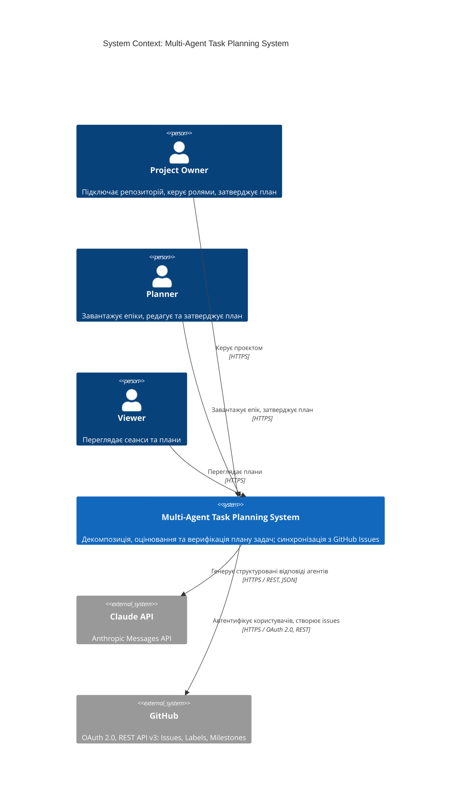
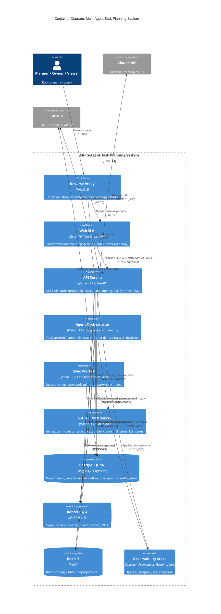

# РОЗДІЛ 2. ОБҐРУНТУВАННЯ АРХІТЕКТУРНИХ РІШЕНЬ ТА ПРОЄКТУВАННЯ СИСТЕМИ

Архітектура описана за методологією C4 Model (Simon Brown) у форматі Diagrams-as-Code (Mermaid.js).
Вимоги, на які посилаються описи, зафіксовано у [SRS](./srs.md); архітектурні рішення — у
каталозі [adr/](./adr/).

## 2.1. Контекстне та контейнерне моделювання системи

### Діаграма рівня 1: System Context

**Опис елементів.**

| Елемент | Тип | Опис | Вимоги |
| --- | --- | --- | --- |
| Project Owner, Planner, Viewer | Person | Ролі моделі RBAC | [SRS-FUN-03](./srs.md#srs-fun-03) |
| Multi-Agent Task Planning System | System | Програмна система, що розробляється | [SRS §1.1](./srs.md#11-призначення-та-межі-системи-scope) |
| Claude API | System_Ext | Зовнішня LLM; виклики через HTTPS з ключем API | [SRS-FUN-07](./srs.md#srs-fun-07) — [SRS-FUN-10](./srs.md#srs-fun-10) |
| GitHub | System_Ext | Identity Provider (OAuth 2.0) та цільовий трекер задач | [SRS-FUN-01](./srs.md#srs-fun-01), [SRS-FUN-13](./srs.md#srs-fun-13) |

### Діаграма рівня 2: Container

**Опис контейнерів.**

| Контейнер | Відповідальність | Вимоги | Рішення |
| --- | --- | --- | --- |
| Reverse Proxy | TLS termination, HSTS, CSP, маршрутизація SPA та API | [SRS-NFR-SEC-05](./srs.md#srs-nfr-sec-05) | — |
| Web SPA | Інтерфейс завантаження, перегляду графа задач та затвердження | [SRS-FUN-06](./srs.md#srs-fun-06), [SRS-FUN-11](./srs.md#srs-fun-11) | — |
| API Service | Автентифікація, RBAC, прийом файлів, створення сеансів, Rate Limiting, SSE, Outbox Relay | [SRS-FUN-01](./srs.md#srs-fun-01) — [SRS-FUN-06](./srs.md#srs-fun-06), [SRS-FUN-17](./srs.md#srs-fun-17), [SRS-NFR-SEC-03](./srs.md#srs-nfr-sec-03) | — |
| Agent Orchestrator | Виконання графа агентів, checkpointing, контроль бюджету | [SRS-FUN-07](./srs.md#srs-fun-07) — [SRS-FUN-12](./srs.md#srs-fun-12), [SRS-FUN-15](./srs.md#srs-fun-15), [SRS-FUN-16](./srs.md#srs-fun-16) | [ADR-001](./adr/0001-agent-orchestration-framework.md) |
| Sync Worker | Ідемпотентна синхронізація плану з GitHub | [SRS-FUN-13](./srs.md#srs-fun-13), [SRS-FUN-14](./srs.md#srs-fun-14), [SRS-NFR-REL-04](./srs.md#srs-nfr-rel-04) | — |
| GitHub MCP Server | Ізоляція доступу до GitHub API, білий список інструментів | [SRS-NFR-SEC-04](./srs.md#srs-nfr-sec-04) | — |
| PostgreSQL 16 + pgvector | Основне сховище, checkpoint-и, outbox, векторний пошук | [SRS-FUN-08](./srs.md#srs-fun-08), [SRS-NFR-REL-05](./srs.md#srs-nfr-rel-05) | — |
| RabbitMQ 4 | Асинхронна доставка подій, competing consumers, DLQ | [SRS-NFR-SCAL-01](./srs.md#srs-nfr-scal-01), [SRS-NFR-REL-04](./srs.md#srs-nfr-rel-04) | — |
| Redis 7 | Token Bucket, Pub/Sub прогресу | [SRS-NFR-SEC-03](./srs.md#srs-nfr-sec-03), [SRS-NFR-PERF-04](./srs.md#srs-nfr-perf-04) | — |
| Observability Stack | Трейси, метрики RED, облік токенів і вартості | [SRS-NFR-OBS-01](./srs.md#srs-nfr-obs-01), [SRS-FUN-15](./srs.md#srs-fun-15) | — |

**Протоколи взаємодії.** Синхронна взаємодія клієнта із системою виконується через HTTPS (REST,
JSON) та Server-Sent Events. Тривалі операції (сеанси планування, синхронізація) винесено в
асинхронний контур через RabbitMQ (AMQP 0-9-1), що забезпечує відповідь API у межах
[SRS-NFR-PERF-02](./srs.md#srs-nfr-perf-02) незалежно від затримки LLM. Доступ до GitHub API
для запису виконується виключно через GitHub MCP Server (MCP, транспорт Streamable HTTP), що
обмежує набір операцій білим списком інструментів.

## 2.2. Компонентне моделювання критичного сервісу системи

Критичним сервісом обрано **Agent Orchestrator**: він містить основне обчислювальне навантаження,
усі виклики LLM та логіку відновлення сеансів.

### Діаграма рівня 3: Component (Agent Orchestrator)

```mermaid
C4Component
    title Component Diagram: Agent Orchestrator

    ContainerQueue(mq, "RabbitMQ", "AMQP 0-9-1")
    ContainerDb(pg, "PostgreSQL + pgvector", "SQL")
    ContainerDb(redis, "Redis", "Pub/Sub")
    System_Ext(claude, "Claude API", "HTTPS")

    Container_Boundary(orch, "Agent Orchestrator") {
        Component(consumer, "SessionEventConsumer", "FastStream subscriber", "Приймає session.created та plan.decision")
        Component(validator, "MessageValidator", "Pydantic v2 DTO", "Валідація схеми повідомлення")
        Component(idem, "IdempotencyGuard", "Middleware", "Відкидає повторно доставлені message_id")
        Component(errh, "ErrorHandler", "Middleware", "Класифікація помилок, nack у DLQ")
        Component(usecase, "RunPlanningSession", "Application Service", "Запуск та відновлення графа сеансу")
        Component(graph, "PlanningGraph", "LangGraph StateGraph", "Вузли та умовні переходи, interrupt")
        Component(planner, "PlannerNode", "Domain", "Декомпозиція Epic → Story → Task")
        Component(estimator, "EstimatorNode", "Domain", "Оцінка story points з RAG")
        Component(deps, "DependencyAnalyzer", "Domain, pure Python", "Цикли, топологічне сортування, критичний шлях")
        Component(reviewer, "ReviewerNode", "Domain", "Верифікація повноти, лічильник ітерацій")
        Component(budget, "BudgetGuard", "Domain Service", "Облік токенів, ліміт сеансу")
        Component(prompt, "PromptBuilder", "Domain Service", "Шаблони промптів, ізоляція вхідних даних")
        Component(llm, "ClaudeAdapter", "langchain-anthropic", "Реалізує LLMPort: retry, circuit breaker, structured output")
        Component(ckpt, "PostgresCheckpointer", "LangGraph PostgresSaver", "Реалізує CheckpointPort")
        Component(repo, "TaskRepository", "SQLAlchemy 2.0", "Реалізує TaskRepositoryPort")
        Component(vec, "SimilarTaskSearch", "pgvector, sentence-transformers", "Реалізує VectorSearchPort")
        Component(progress, "ProgressPublisher", "redis-py", "Реалізує ProgressPort")
        Component(tracer, "Telemetry", "OpenTelemetry SDK, Langfuse", "Трейси вузлів і LLM-викликів")
    }

    Rel(mq, consumer, "Доставляє повідомлення", "AMQP")
    Rel(consumer, validator, "Передає payload", "Middleware chain")
    Rel(validator, idem, "Валідний DTO", "Middleware chain")
    Rel(idem, usecase, "Викликає", "Interface call")
    Rel(errh, consumer, "Обгортає обробник", "Decorator")
    Rel(usecase, graph, "invoke / resume", "Interface call")
    Rel(graph, planner, "Вузол", "Graph edge")
    Rel(graph, estimator, "Вузол", "Graph edge")
    Rel(graph, deps, "Вузол", "Graph edge")
    Rel(graph, reviewer, "Вузол, умовний перехід", "Conditional edge")
    Rel(graph, ckpt, "Зберігає стан після вузла", "CheckpointPort (DI)")
    Rel(planner, prompt, "Формує промпт", "Interface call")
    Rel(planner, llm, "Structured output", "LLMPort (DI)")
    Rel(estimator, vec, "top-k = 5", "VectorSearchPort (DI)")
    Rel(estimator, llm, "Structured output", "LLMPort (DI)")
    Rel(reviewer, llm, "Structured output", "LLMPort (DI)")
    Rel(llm, budget, "Повідомляє usage", "Observer")
    Rel(usecase, repo, "Зберігає план", "TaskRepositoryPort (DI)")
    Rel(usecase, progress, "Подія прогресу", "ProgressPort (DI)")
    Rel(llm, claude, "Messages API", "HTTPS")
    Rel(ckpt, pg, "SQL", "TCP")
    Rel(repo, pg, "SQL", "TCP")
    Rel(vec, pg, "Векторний пошук", "SQL / TCP")
    Rel(progress, redis, "PUBLISH", "RESP")
    Rel(llm, tracer, "Span LLM-виклику", "Callback")

    UpdateLayoutConfig($c4ShapeInRow="4", $c4BoundaryInRow="1")
```

**Опис шарів та компонентів.**

| Шар | Компонент | Призначення | Вимоги |
| --- | --- | --- | --- |
| Inbound | SessionEventConsumer | Підписник черг `session.created` і `plan.decision`; ручне підтвердження (manual ack) після фіксації checkpoint | [SRS-FUN-05](./srs.md#srs-fun-05), [SRS-FUN-11](./srs.md#srs-fun-11) |
| Inbound | MessageValidator | Перевірка повідомлення за Pydantic-схемою; невалідні повідомлення спрямовуються в DLQ без повторів | [SRS-NFR-REL-04](./srs.md#srs-nfr-rel-04) |
| Inbound | IdempotencyGuard | Реєстрація `message_id` у PostgreSQL; повторна доставка не запускає граф удруге | [SRS-NFR-REL-04](./srs.md#srs-nfr-rel-04) |
| Inbound | ErrorHandler | Розділення помилок на transient (requeue з затримкою) та permanent (DLQ) | [SRS-NFR-REL-02](./srs.md#srs-nfr-rel-02) |
| Application | RunPlanningSession | Use case запуску та відновлення сеансу за `thread_id` | [SRS-FUN-12](./srs.md#srs-fun-12) |
| Core | PlanningGraph | Граф станів; умовний перехід Reviewer → Planner обмежено лічильником ітерацій; interrupt перед завершенням | [SRS-FUN-10](./srs.md#srs-fun-10), [SRS-FUN-11](./srs.md#srs-fun-11) |
| Core | PlannerNode, EstimatorNode, ReviewerNode | Вузли агентів; залежать лише від портів | [SRS-FUN-07](./srs.md#srs-fun-07), [SRS-FUN-08](./srs.md#srs-fun-08), [SRS-FUN-10](./srs.md#srs-fun-10) |
| Core | DependencyAnalyzer | Детермінований аналіз графа без виклику LLM (алгоритм Кана, пошук циклів DFS, критичний шлях) | [SRS-FUN-09](./srs.md#srs-fun-09) |
| Core | BudgetGuard | Агрегація usage з відповідей LLM; перериває сеанс при перевищенні ліміту | [SRS-FUN-16](./srs.md#srs-fun-16), [SRS-NFR-COST-01](./srs.md#srs-nfr-cost-01) |
| Core | PromptBuilder | Розміщення вмісту документа в окремому блоці даних, відокремленому від інструкцій | [SRS-NFR-SEC-04](./srs.md#srs-nfr-sec-04) |
| Outbound | ClaudeAdapter | Реалізація `LLMPort`; retry з backoff та circuit breaker; `max_tokens` | [SRS-NFR-REL-02](./srs.md#srs-nfr-rel-02), [SRS-NFR-COST-02](./srs.md#srs-nfr-cost-02) |
| Outbound | PostgresCheckpointer | Збереження стану графа після кожного вузла | [SRS-NFR-REL-03](./srs.md#srs-nfr-rel-03) |
| Outbound | TaskRepository, SimilarTaskSearch | Доступ до задач і векторного індексу | [SRS-FUN-08](./srs.md#srs-fun-08) |
| Outbound | ProgressPublisher, Telemetry | Події прогресу, трейси та облік токенів | [SRS-FUN-06](./srs.md#srs-fun-06), [SRS-FUN-15](./srs.md#srs-fun-15), [SRS-NFR-OBS-01](./srs.md#srs-nfr-obs-01) |

**Правило залежностей.** Компоненти шару Core залежать лише від портів (`LLMPort`,
`CheckpointPort`, `TaskRepositoryPort`, `VectorSearchPort`, `ProgressPort`). Реалізації портів
впроваджуються під час старту процесу (Dependency Injection), що дозволяє тестувати вузли графа з
mock-реалізацією LLM і виконувати перевірки [SRS-FUN-10](./srs.md#srs-fun-10) без звернення до
Claude API. Вибір LangGraph як механізму оркестрування обґрунтовано в
[ADR-001](./adr/0001-agent-orchestration-framework.md).

## 2.3. Документування архітектурних рішень

| ID | Рішення | Статус |
| --- | --- | --- |
| [ADR-001](./adr/0001-agent-orchestration-framework.md) | Вибір фреймворку оркестрування агентів: LangGraph | Approved |
