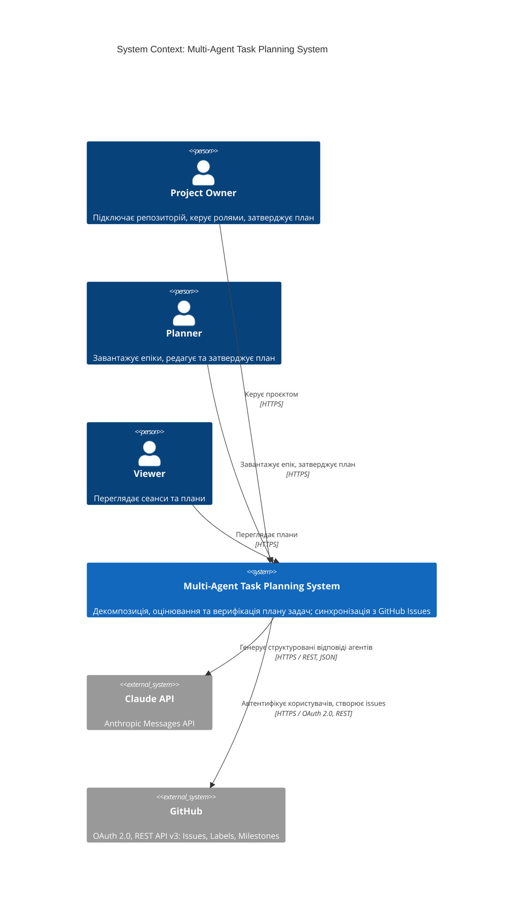
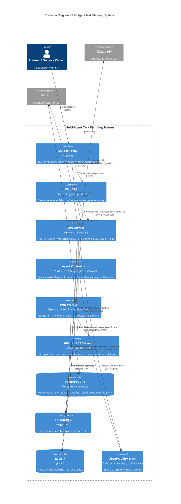
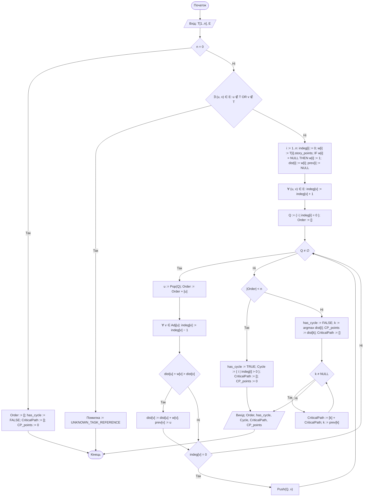

# РОЗДІЛ 2. ОБҐРУНТУВАННЯ АРХІТЕКТУРНИХ РІШЕНЬ ТА ПРОЄКТУВАННЯ СИСТЕМИ

Архітектура описана за методологією C4 Model (Simon Brown) у форматі Diagrams-as-Code (Mermaid.js).
Вимоги, на які посилаються описи, зафіксовано у [SRS](./srs.md); архітектурні рішення — у
каталозі [adr/](./adr/).

## 2.1. Контекстне та контейнерне моделювання системи

### Діаграма рівня 1: System Context

**Опис елементів.**

| Елемент | Тип | Опис | Вимоги |
| --- | --- | --- | --- |
| Project Owner, Planner, Viewer | Person | Ролі моделі RBAC | [SRS-FUN-03](./srs.md#srs-fun-03) |
| Multi-Agent Task Planning System | System | Програмна система, що розробляється | [SRS §1.1](./srs.md#11-призначення-та-межі-системи-scope) |
| Claude API | System_Ext | Зовнішня LLM; виклики через HTTPS з ключем API | [SRS-FUN-07](./srs.md#srs-fun-07) — [SRS-FUN-10](./srs.md#srs-fun-10) |
| GitHub | System_Ext | Identity Provider (OAuth 2.0) та цільовий трекер задач | [SRS-FUN-01](./srs.md#srs-fun-01), [SRS-FUN-13](./srs.md#srs-fun-13) |

### Діаграма рівня 2: Container

**Опис контейнерів.**

| Контейнер | Відповідальність | Вимоги | Рішення |
| --- | --- | --- | --- |
| Reverse Proxy | TLS termination, HSTS, CSP, маршрутизація SPA та API | [SRS-NFR-SEC-05](./srs.md#srs-nfr-sec-05) | — |
| Web SPA | Інтерфейс завантаження, перегляду графа задач та затвердження | [SRS-FUN-06](./srs.md#srs-fun-06), [SRS-FUN-11](./srs.md#srs-fun-11) | — |
| API Service | Автентифікація, RBAC, прийом файлів, створення сеансів, Rate Limiting, SSE, Outbox Relay | [SRS-FUN-01](./srs.md#srs-fun-01) — [SRS-FUN-06](./srs.md#srs-fun-06), [SRS-FUN-17](./srs.md#srs-fun-17), [SRS-NFR-SEC-03](./srs.md#srs-nfr-sec-03) | — |
| Agent Orchestrator | Виконання графа агентів, checkpointing, контроль бюджету | [SRS-FUN-07](./srs.md#srs-fun-07) — [SRS-FUN-12](./srs.md#srs-fun-12), [SRS-FUN-15](./srs.md#srs-fun-15), [SRS-FUN-16](./srs.md#srs-fun-16) | [ADR-001](./adr/0001-agent-orchestration-framework.md) |
| Sync Worker | Ідемпотентна синхронізація плану з GitHub | [SRS-FUN-13](./srs.md#srs-fun-13), [SRS-FUN-14](./srs.md#srs-fun-14), [SRS-NFR-REL-04](./srs.md#srs-nfr-rel-04) | — |
| GitHub MCP Server | Ізоляція доступу до GitHub API, білий список інструментів | [SRS-NFR-SEC-04](./srs.md#srs-nfr-sec-04) | — |
| PostgreSQL 16 + pgvector | Основне сховище, checkpoint-и, outbox, векторний пошук | [SRS-FUN-08](./srs.md#srs-fun-08), [SRS-NFR-REL-05](./srs.md#srs-nfr-rel-05) | — |
| RabbitMQ 4 | Асинхронна доставка подій, competing consumers, DLQ | [SRS-NFR-SCAL-01](./srs.md#srs-nfr-scal-01), [SRS-NFR-REL-04](./srs.md#srs-nfr-rel-04) | — |
| Redis 7 | Token Bucket, Pub/Sub прогресу | [SRS-NFR-SEC-03](./srs.md#srs-nfr-sec-03), [SRS-NFR-PERF-04](./srs.md#srs-nfr-perf-04) | — |
| Observability Stack | Трейси, метрики RED, облік токенів і вартості | [SRS-NFR-OBS-01](./srs.md#srs-nfr-obs-01), [SRS-FUN-15](./srs.md#srs-fun-15) | — |

**Протоколи взаємодії.** Синхронна взаємодія клієнта із системою виконується через HTTPS (REST,
JSON) та Server-Sent Events. Тривалі операції (сеанси планування, синхронізація) винесено в
асинхронний контур через RabbitMQ (AMQP 0-9-1), що забезпечує відповідь API у межах
[SRS-NFR-PERF-02](./srs.md#srs-nfr-perf-02) незалежно від затримки LLM. Доступ до GitHub API
для запису виконується виключно через GitHub MCP Server (MCP, транспорт Streamable HTTP), що
обмежує набір операцій білим списком інструментів.

## 2.2. Компонентне моделювання критичного сервісу системи

Критичним сервісом обрано **Agent Orchestrator**: він містить основне обчислювальне навантаження,
усі виклики LLM та логіку відновлення сеансів.

### Діаграма рівня 3: Component (Agent Orchestrator)

```mermaid
C4Component
    title Component Diagram: Agent Orchestrator

    ContainerQueue(mq, "RabbitMQ", "AMQP 0-9-1")
    ContainerDb(pg, "PostgreSQL + pgvector", "SQL")
    ContainerDb(redis, "Redis", "Pub/Sub")
    System_Ext(claude, "Claude API", "HTTPS")

    Container_Boundary(orch, "Agent Orchestrator") {
        Component(consumer, "SessionEventConsumer", "FastStream subscriber", "Приймає session.created та plan.decision")
        Component(validator, "MessageValidator", "Pydantic v2 DTO", "Валідація схеми повідомлення")
        Component(idem, "IdempotencyGuard", "Middleware", "Відкидає повторно доставлені message_id")
        Component(errh, "ErrorHandler", "Middleware", "Класифікація помилок, nack у DLQ")
        Component(usecase, "RunPlanningSession", "Application Service", "Запуск та відновлення графа сеансу")
        Component(graph, "PlanningGraph", "LangGraph StateGraph", "Вузли та умовні переходи, interrupt")
        Component(planner, "PlannerNode", "Domain", "Декомпозиція Epic → Story → Task")
        Component(estimator, "EstimatorNode", "Domain", "Оцінка story points з RAG")
        Component(deps, "DependencyAnalyzer", "Domain, pure Python", "Цикли, топологічне сортування, критичний шлях")
        Component(reviewer, "ReviewerNode", "Domain", "Верифікація повноти, лічильник ітерацій")
        Component(budget, "BudgetGuard", "Domain Service", "Облік токенів, ліміт сеансу")
        Component(prompt, "PromptBuilder", "Domain Service", "Шаблони промптів, ізоляція вхідних даних")
        Component(llm, "ClaudeAdapter", "langchain-anthropic", "Реалізує LLMPort: retry, circuit breaker, structured output")
        Component(ckpt, "PostgresCheckpointer", "LangGraph PostgresSaver", "Реалізує CheckpointPort")
        Component(repo, "TaskRepository", "SQLAlchemy 2.0", "Реалізує TaskRepositoryPort")
        Component(vec, "SimilarTaskSearch", "pgvector, sentence-transformers", "Реалізує VectorSearchPort")
        Component(progress, "ProgressPublisher", "redis-py", "Реалізує ProgressPort")
        Component(tracer, "Telemetry", "OpenTelemetry SDK, Langfuse", "Трейси вузлів і LLM-викликів")
    }

    Rel(mq, consumer, "Доставляє повідомлення", "AMQP")
    Rel(consumer, validator, "Передає payload", "Middleware chain")
    Rel(validator, idem, "Валідний DTO", "Middleware chain")
    Rel(idem, usecase, "Викликає", "Interface call")
    Rel(errh, consumer, "Обгортає обробник", "Decorator")
    Rel(usecase, graph, "invoke / resume", "Interface call")
    Rel(graph, planner, "Вузол", "Graph edge")
    Rel(graph, estimator, "Вузол", "Graph edge")
    Rel(graph, deps, "Вузол", "Graph edge")
    Rel(graph, reviewer, "Вузол, умовний перехід", "Conditional edge")
    Rel(graph, ckpt, "Зберігає стан після вузла", "CheckpointPort (DI)")
    Rel(planner, prompt, "Формує промпт", "Interface call")
    Rel(planner, llm, "Structured output", "LLMPort (DI)")
    Rel(estimator, vec, "top-k = 5", "VectorSearchPort (DI)")
    Rel(estimator, llm, "Structured output", "LLMPort (DI)")
    Rel(reviewer, llm, "Structured output", "LLMPort (DI)")
    Rel(llm, budget, "Повідомляє usage", "Observer")
    Rel(usecase, repo, "Зберігає план", "TaskRepositoryPort (DI)")
    Rel(usecase, progress, "Подія прогресу", "ProgressPort (DI)")
    Rel(llm, claude, "Messages API", "HTTPS")
    Rel(ckpt, pg, "SQL", "TCP")
    Rel(repo, pg, "SQL", "TCP")
    Rel(vec, pg, "Векторний пошук", "SQL / TCP")
    Rel(progress, redis, "PUBLISH", "RESP")
    Rel(llm, tracer, "Span LLM-виклику", "Callback")

    UpdateLayoutConfig($c4ShapeInRow="4", $c4BoundaryInRow="1")
```

**Опис шарів та компонентів.**

| Шар | Компонент | Призначення | Вимоги |
| --- | --- | --- | --- |
| Inbound | SessionEventConsumer | Підписник черг `session.created` і `plan.decision`; ручне підтвердження (manual ack) після фіксації checkpoint | [SRS-FUN-05](./srs.md#srs-fun-05), [SRS-FUN-11](./srs.md#srs-fun-11) |
| Inbound | MessageValidator | Перевірка повідомлення за Pydantic-схемою; невалідні повідомлення спрямовуються в DLQ без повторів | [SRS-NFR-REL-04](./srs.md#srs-nfr-rel-04) |
| Inbound | IdempotencyGuard | Реєстрація `message_id` у PostgreSQL; повторна доставка не запускає граф удруге | [SRS-NFR-REL-04](./srs.md#srs-nfr-rel-04) |
| Inbound | ErrorHandler | Розділення помилок на transient (requeue з затримкою) та permanent (DLQ) | [SRS-NFR-REL-02](./srs.md#srs-nfr-rel-02) |
| Application | RunPlanningSession | Use case запуску та відновлення сеансу за `thread_id` | [SRS-FUN-12](./srs.md#srs-fun-12) |
| Core | PlanningGraph | Граф станів; умовний перехід Reviewer → Planner обмежено лічильником ітерацій; interrupt перед завершенням | [SRS-FUN-10](./srs.md#srs-fun-10), [SRS-FUN-11](./srs.md#srs-fun-11) |
| Core | PlannerNode, EstimatorNode, ReviewerNode | Вузли агентів; залежать лише від портів | [SRS-FUN-07](./srs.md#srs-fun-07), [SRS-FUN-08](./srs.md#srs-fun-08), [SRS-FUN-10](./srs.md#srs-fun-10) |
| Core | DependencyAnalyzer | Детермінований аналіз графа без виклику LLM (алгоритм Кана, пошук циклів DFS, критичний шлях) | [SRS-FUN-09](./srs.md#srs-fun-09) |
| Core | BudgetGuard | Агрегація usage з відповідей LLM; перериває сеанс при перевищенні ліміту | [SRS-FUN-16](./srs.md#srs-fun-16), [SRS-NFR-COST-01](./srs.md#srs-nfr-cost-01) |
| Core | PromptBuilder | Розміщення вмісту документа в окремому блоці даних, відокремленому від інструкцій | [SRS-NFR-SEC-04](./srs.md#srs-nfr-sec-04) |
| Outbound | ClaudeAdapter | Реалізація `LLMPort`; retry з backoff та circuit breaker; `max_tokens` | [SRS-NFR-REL-02](./srs.md#srs-nfr-rel-02), [SRS-NFR-COST-02](./srs.md#srs-nfr-cost-02) |
| Outbound | PostgresCheckpointer | Збереження стану графа після кожного вузла | [SRS-NFR-REL-03](./srs.md#srs-nfr-rel-03) |
| Outbound | TaskRepository, SimilarTaskSearch | Доступ до задач і векторного індексу | [SRS-FUN-08](./srs.md#srs-fun-08) |
| Outbound | ProgressPublisher, Telemetry | Події прогресу, трейси та облік токенів | [SRS-FUN-06](./srs.md#srs-fun-06), [SRS-FUN-15](./srs.md#srs-fun-15), [SRS-NFR-OBS-01](./srs.md#srs-nfr-obs-01) |

**Правило залежностей.** Компоненти шару Core залежать лише від портів (`LLMPort`,
`CheckpointPort`, `TaskRepositoryPort`, `VectorSearchPort`, `ProgressPort`). Реалізації портів
впроваджуються під час старту процесу (Dependency Injection), що дозволяє тестувати вузли графа з
mock-реалізацією LLM і виконувати перевірки [SRS-FUN-10](./srs.md#srs-fun-10) без звернення до
Claude API. Вибір LangGraph як механізму оркестрування обґрунтовано в
[ADR-001](./adr/0001-agent-orchestration-framework.md).

## 2.3. Документування архітектурних рішень

| ID | Рішення | Статус |
| --- | --- | --- |
| [ADR-001](./adr/0001-agent-orchestration-framework.md) | Вибір фреймворку оркестрування агентів: LangGraph | Approved |

## 2.4. Проєктування та моделювання баз даних

Шар збереження даних реалізовано в PostgreSQL 16 з розширенням pgvector (контейнер
PostgreSQL 16, [C4 Level 2](#діаграма-рівня-2-container)). Таблиці checkpoint-ів LangGraph
(`checkpoints`, `checkpoint_writes`, `checkpoint_blobs`) створюються бібліотекою
`langgraph-checkpoint-postgres` в окремій схемі `langgraph` і в модель предметної області не
входять ([ADR-001](./adr/0001-agent-orchestration-framework.md)).

### Діаграма сутностей (ERD)

### Типи переліків (ENUM)

| Тип | Значення |
| --- | --- |
| `project_role` | `OWNER`, `PLANNER`, `VIEWER` |
| `session_status` | `QUEUED`, `RUNNING`, `AWAITING_APPROVAL`, `APPROVED`, `REJECTED`, `SYNCING`, `COMPLETED`, `SYNC_FAILED`, `FAILED`, `BUDGET_EXCEEDED` |
| `task_level` | `EPIC`, `STORY`, `TASK` |
| `sync_status` | `PENDING`, `IN_PROGRESS`, `SYNCED`, `FAILED` |

### Специфікація таблиць

**users** — користувачі, автентифіковані через GitHub ([SRS-FUN-01](./srs.md#srs-fun-01)).

| Поле | Тип | Обмеження | Опис |
| --- | --- | --- | --- |
| id | UUID | PK, `DEFAULT gen_random_uuid()` | Ідентифікатор |
| github_id | BIGINT | UNIQUE, NOT NULL | Ідентифікатор користувача GitHub |
| login | VARCHAR(39) | NOT NULL | Логін GitHub (максимальна довжина — 39 символів) |
| email | VARCHAR(254) | NULL | Адреса електронної пошти (RFC 5321) |
| github_token_enc | BYTEA | NOT NULL | Зашифрований токен доступу GitHub ([SRS-NFR-SEC-02](./srs.md#srs-nfr-sec-02)) |
| github_token_nonce | BYTEA | NOT NULL, `octet_length = 12` | Nonce AES-256-GCM |
| created_at, updated_at | TIMESTAMPTZ | NOT NULL, `DEFAULT now()` | Технічні мітки часу |
| deleted_at | TIMESTAMPTZ | NULL | Soft delete; фізичне видалення — фоновою задачею за [SRS-NFR-SEC-08](./srs.md#srs-nfr-sec-08) |

**refresh_tokens** — refresh-токени ([SRS-NFR-SEC-01](./srs.md#srs-nfr-sec-01)); зберігається лише
SHA-256 хеш токена (`CHAR(64)`, UNIQUE), що виключає компрометацію при витоку БД.

**projects** — проєкти, прив'язані до репозиторію GitHub. `github_repo VARCHAR(140)` UNIQUE
серед записів з `deleted_at IS NULL` (частковий унікальний індекс).

**project_members** — модель RBAC ([SRS-FUN-03](./srs.md#srs-fun-03)); складений PK
(`project_id`, `user_id`) виключає дублювання членства.

**planning_sessions** — сеанси планування.

| Поле | Тип | Обмеження | Опис |
| --- | --- | --- | --- |
| id | UUID | PK | Ідентифікатор сеансу; використовується як `thread_id` LangGraph |
| project_id, created_by | UUID | FK → projects, users; NOT NULL | Власність ресурсу для перевірки IDOR |
| status | session_status | NOT NULL, `DEFAULT 'QUEUED'` | Стан сеансу |
| source_filename | VARCHAR(255) | NOT NULL | Ім'я файлу після санітизації |
| source_mime | VARCHAR(100) | `CHECK IN ('text/markdown', 'application/pdf')` | Тип вмісту ([SRS-FUN-04](./srs.md#srs-fun-04)) |
| source_size_bytes | INTEGER | `CHECK (source_size_bytes BETWEEN 1 AND 10485760)` | Розмір файлу ≤ 10 МБ |
| source_sha256 | CHAR(64) | NOT NULL | Хеш вмісту для виявлення повторних завантажень |
| source_text | TEXT | NOT NULL | Вилучений текст документа |
| review_iterations | SMALLINT | `CHECK (review_iterations BETWEEN 0 AND 3)` | Лічильник ітерацій Reviewer ([SRS-FUN-10](./srs.md#srs-fun-10)) |
| tokens_used | INTEGER | NOT NULL, `DEFAULT 0` | Спожиті токени ([SRS-FUN-15](./srs.md#srs-fun-15)) |
| token_budget | INTEGER | NOT NULL, `DEFAULT 250000` | Ліміт ([SRS-NFR-COST-01](./srs.md#srs-nfr-cost-01)) |
| cost_usd | NUMERIC(10,4) | NOT NULL, `DEFAULT 0` | Вартість сеансу; NUMERIC виключає похибки FLOAT |
| error_code | VARCHAR(64) | NULL | Машиночитний код помилки для `FAILED` / `SYNC_FAILED` |
| version | INTEGER | NOT NULL, `DEFAULT 1` | Оптимістичне блокування при зміні статусу |
| created_at, updated_at, completed_at | TIMESTAMPTZ | — | Мітки часу |

**tasks** — вузли плану (ієрархія Epic → Story → Task, [SRS-FUN-07](./srs.md#srs-fun-07)).

| Поле | Тип | Обмеження | Опис |
| --- | --- | --- | --- |
| id | UUID | PK | Ідентифікатор задачі |
| session_id | UUID | FK → planning_sessions `ON DELETE CASCADE` | Належність до сеансу |
| parent_id | UUID | FK → tasks, NULL | Батьківський вузол; NULL лише для `EPIC` (`CHECK`) |
| level | task_level | NOT NULL | Рівень ієрархії |
| title | VARCHAR(256) | NOT NULL, довжина ≥ 3 | Заголовок (ліміт заголовка issue GitHub — 256) |
| description | TEXT | NOT NULL | Опис і критерії приймання |
| story_points | SMALLINT | `CHECK (story_points IN (1, 2, 3, 5, 8, 13))`, NULL | Оцінка; NULL до виконання Estimator ([SRS-FUN-08](./srs.md#srs-fun-08)) |
| position | INTEGER | NOT NULL | Порядок серед сусідніх вузлів |
| sync_key | UUID | UNIQUE, NOT NULL | Ключ ідемпотентності синхронізації ([SRS-FUN-14](./srs.md#srs-fun-14)) |
| sync_status | sync_status | NOT NULL, `DEFAULT 'PENDING'` | Стан синхронізації |
| github_issue_number | INTEGER | NULL | Номер створеного issue |
| version | INTEGER | NOT NULL, `DEFAULT 1` | Оптимістичне блокування при редагуванні плану |
| created_at, updated_at | TIMESTAMPTZ | — | Мітки часу |

**task_dependencies** — ребра графа залежностей ([SRS-FUN-09](./srs.md#srs-fun-09)); складений PK,
`CHECK (task_id <> depends_on_task_id)` виключає петлі; цикли довжини ≥ 2 виявляються
алгоритмом [2.6.2](#262-алгоритм-аналізу-залежностей-та-критичного-шляху).

**historical_tasks** — завершені задачі проєкту для RAG; `embedding VECTOR(768)` (модель
`multilingual-e5-base`).

**llm_usage** — облік викликів LLM ([SRS-FUN-15](./srs.md#srs-fun-15)); `cost_usd NUMERIC(10,6)`,
`trace_id CHAR(32)` для зв'язку з трейсами OpenTelemetry ([SRS-NFR-OBS-01](./srs.md#srs-nfr-obs-01)).

**outbox_events** — Transactional Outbox: подія записується в одній транзакції зі зміною стану
сеансу та публікується Outbox Relay ([SRS-NFR-REL-04](./srs.md#srs-nfr-rel-04)).

**processed_messages** — реєстр оброблених повідомлень для ідемпотентних споживачів; складений
PK (`message_id`, `consumer`).

**audit_log** — журнал аудиту ([SRS-FUN-17](./srs.md#srs-fun-17)); лише INSERT (права UPDATE та
DELETE для ролі застосунку відкликано).

### План індексування

| Таблиця | Індекс | Тип | Обґрунтування |
| --- | --- | --- | --- |
| planning_sessions | `(project_id, created_at DESC)` | B-Tree | Пагінований список сеансів проєкту |
| planning_sessions | `(status) WHERE status IN ('QUEUED', 'RUNNING', 'SYNCING')` | B-Tree, частковий | Моніторинг активних сеансів |
| tasks | `(session_id, parent_id, position)` | B-Tree | Побудова дерева плану одним запитом |
| tasks | `(sync_key)` | B-Tree, UNIQUE | Перевірка ідемпотентності |
| task_dependencies | `(depends_on_task_id)` | B-Tree | Зворотний обхід графа |
| historical_tasks | `(embedding vector_cosine_ops)` | HNSW (`m = 16`, `ef_construction = 64`) | Пошук top-k = 5 за косинусною відстанню |
| historical_tasks | `(project_id)` | B-Tree | Фільтр векторного пошуку за проєктом |
| outbox_events | `(created_at) WHERE published_at IS NULL` | B-Tree, частковий | Вибірка неопублікованих подій Outbox Relay |
| llm_usage | `(session_id)` | B-Tree | Агрегація вартості сеансу |
| llm_usage, audit_log | `(created_at)` | BRIN | Діапазонні запити до журналів з монотонним часом вставки |
| project_members | `(user_id)` | B-Tree | Перелік проєктів користувача |
| refresh_tokens | `(token_hash)` | B-Tree, UNIQUE | Перевірка refresh-токена |

## 2.5. Специфікація міжсервісних контрактів (API)

Контракт взаємодії Web SPA → API Service зафіксовано за підходом API-First у форматі
OpenAPI 3.0.3: [openapi.yaml](./api/openapi.yaml). Контракт є джерелом для генерації
клієнтського SDK SPA та серверних моделей Pydantic.

| Метод | Шлях | Призначення | Вимоги |
| --- | --- | --- | --- |
| POST | `/auth/refresh` | Ротація refresh-токена та видача access JWT | [SRS-FUN-02](./srs.md#srs-fun-02), [SRS-NFR-SEC-01](./srs.md#srs-nfr-sec-01) |
| POST | `/projects/{projectId}/sessions` | Завантаження епіку, створення сеансу, 202 Accepted | [SRS-FUN-04](./srs.md#srs-fun-04), [SRS-FUN-05](./srs.md#srs-fun-05) |
| GET | `/projects/{projectId}/sessions` | Пагінований список сеансів (`page`, `limit ≤ 100`) | [SRS-FUN-03](./srs.md#srs-fun-03) |
| GET | `/sessions/{sessionId}` | Стан сеансу | [SRS-FUN-03](./srs.md#srs-fun-03) |
| GET | `/sessions/{sessionId}/events` | Server-Sent Events прогресу | [SRS-FUN-06](./srs.md#srs-fun-06) |
| GET | `/sessions/{sessionId}/plan` | План, граф залежностей, критичний шлях | [SRS-FUN-07](./srs.md#srs-fun-07) — [SRS-FUN-09](./srs.md#srs-fun-09) |
| PATCH | `/sessions/{sessionId}/plan/tasks/{taskId}` | Редагування задачі з оптимістичним блокуванням (`If-Match`) | [SRS-FUN-11](./srs.md#srs-fun-11) |
| POST | `/sessions/{sessionId}/decision` | Затвердження або відхилення плану (`Idempotency-Key`) | [SRS-FUN-11](./srs.md#srs-fun-11), [SRS-FUN-13](./srs.md#srs-fun-13) |

**Безпека.** Усі ендпоінти, крім `/auth/refresh`, вимагають `bearerAuth` (JWT). Запит до ресурсу
поза проєктами користувача повертає 404 замість 403, що не розкриває факт існування ресурсу.
Ліміти запитів повідомляються заголовками `X-RateLimit-*` та `Retry-After`.

**Обробка помилок.** Усі помилки повертаються як `application/problem+json` (RFC 9457) з полем
`trace_id`; для 400 — масив `errors` з переліком полів. Задокументовано статуси 400, 401, 403,
404, 409, 412, 413, 415, 429, 503.

**Асинхронні контракти.** Події між контейнерами передаються через RabbitMQ:

| Подія | Продюсер → Споживач | Payload |
| --- | --- | --- |
| `session.created` | API Service (Outbox Relay) → Agent Orchestrator | `message_id`, `session_id`, `project_id` |
| `plan.decision` | API Service (Outbox Relay) → Agent Orchestrator | `message_id`, `session_id`, `decision` |
| `plan.approved` | Agent Orchestrator → Sync Worker | `message_id`, `session_id`, `github_repo` |

## 2.6. Моделювання логіки критичних вузлів

Позначення: `:=` — присвоювання; `=` — порівняння; `AND`, `OR`, `NOT` — логічні оператори;
`X[i]` — i-й елемент масиву; `|X|` — потужність множини або довжина масиву.

### 2.6.1. Алгоритм оркестрування сеансу планування

Реалізується вузлами PlanningGraph ([2.2](#22-компонентне-моделювання-критичного-сервісу-системи))
та забезпечує [SRS-FUN-07](./srs.md#srs-fun-07) — [SRS-FUN-11](./srs.md#srs-fun-11),
[SRS-FUN-16](./srs.md#srs-fun-16).

**Вхід:** `S` — сеанс, `Doc := S.source_text`, `B := S.token_budget`, `N_max := 3`.
**Вихід:** `S.status ∈ {AWAITING_APPROVAL, FAILED, BUDGET_EXCEEDED}`.

1. `S.status := RUNNING`.
2. ЯКЩО `Doc = NULL OR |Doc| = 0` → `S.status := FAILED`, `S.error_code := EMPTY_INPUT`, кінець.
3. `i := S.review_iterations`, `Feedback := NULL`.
4. `Plan := Planner(Doc, Feedback)`; `S.tokens_used := S.tokens_used + Plan.usage`.
5. ЯКЩО `Plan = NULL OR NOT Valid(Plan)` після 2 повторних запитів → `S.status := FAILED`,
   `S.error_code := INVALID_LLM_OUTPUT`, кінець. `Valid(Plan)` перевіряє JSON Schema та
   посилальну цілісність: кожна залежність посилається на задачу з `Plan.Tasks`.
6. ЯКЩО `S.tokens_used > B` → `S.status := BUDGET_EXCEEDED`, кінець.
7. ДЛЯ `j := 1` ДО `|Plan.Tasks|`: `Similar := TopK(Plan.Tasks[j], 5)`;
   `Plan.Tasks[j].story_points := Estimator(Plan.Tasks[j], Similar)`;
   `S.tokens_used := S.tokens_used + usage`.
8. ЯКЩО `S.tokens_used > B` → `S.status := BUDGET_EXCEEDED`, кінець.
9. `G := AnalyzeDependencies(Plan)` (алгоритм 2.6.2).
10. `R := Reviewer(Plan, G)`; `S.tokens_used := S.tokens_used + R.usage`.
11. ЯКЩО `(R.approved = TRUE AND G.has_cycle = FALSE) OR i = N_max` →
    `Save(Plan.Tasks, G.edges)`, `S.status := AWAITING_APPROVAL`, `interrupt()`, кінець.
12. `i := i + 1`; `S.review_iterations := i`; `Feedback := R.comments + G.cycle`; перехід до кроку 4.

Після кожного кроку графа виконується checkpoint. Виклики LLM на кроках 4, 7, 10 загорнуті в
retry та circuit breaker ([SRS-NFR-REL-02](./srs.md#srs-nfr-rel-02)); помилка після вичерпання
спроб переводить сеанс у `FAILED` з `error_code := LLM_UNAVAILABLE`.

### 2.6.2. Алгоритм аналізу залежностей та критичного шляху

Модифікований алгоритм Кана з обчисленням найдовшого шляху за сумою story points
([SRS-FUN-09](./srs.md#srs-fun-09)). Складність — O(n + m), де n — кількість задач,
m — кількість залежностей.

**Вхід:** `T[1..n]` — задачі, `E` — множина ребер `(u, v)`: задача `v` залежить від `u`.
**Вихід:** `Order`, `has_cycle`, `Cycle`, `CriticalPath`, `CP_points`.

1. ЯКЩО `n = 0` → `Order := []`, `has_cycle := FALSE`, `CriticalPath := []`, `CP_points := 0`, кінець.
2. ДЛЯ КОЖНОГО `(u, v) ∈ E`: ЯКЩО `u ∉ T OR v ∉ T` → помилка `UNKNOWN_TASK_REFERENCE`, кінець
   (захисна перевірка: у потоці 2.6.1 такі посилання відхиляються функцією `Valid(Plan)`).
3. ДЛЯ `i := 1` ДО `n`: `indeg[i] := 0`; `w[i] := T[i].story_points`; ЯКЩО `w[i] = NULL` → `w[i] := 1`;
   `dist[i] := w[i]`; `prev[i] := NULL`.
4. ДЛЯ КОЖНОГО `(u, v) ∈ E`: `indeg[v] := indeg[v] + 1`.
5. `Q := { i | indeg[i] = 0 }`; `Order := []`.
6. ПОКИ `Q ≠ ∅`: `u := Pop(Q)`; `Order := Order + [u]`;
   ДЛЯ КОЖНОГО `v ∈ Adj[u]`: `indeg[v] := indeg[v] − 1`;
   ЯКЩО `dist[u] + w[v] > dist[v]` → `dist[v] := dist[u] + w[v]`, `prev[v] := u`;
   ЯКЩО `indeg[v] = 0` → `Push(Q, v)`.
7. ЯКЩО `|Order| < n` → `has_cycle := TRUE`; `Cycle := { i | indeg[i] > 0 }`;
   `CriticalPath := []`; `CP_points := 0`; кінець.
8. `has_cycle := FALSE`; `k := argmax dist[i]`; `CP_points := dist[k]`; `CriticalPath := []`.
9. ПОКИ `k ≠ NULL`: `CriticalPath := [k] + CriticalPath`; `k := prev[k]`.

### 2.6.3. Алгоритм ідемпотентної синхронізації плану з GitHub Issues

Виконується Sync Worker при споживанні події `plan.approved`
([SRS-FUN-13](./srs.md#srs-fun-13), [SRS-FUN-14](./srs.md#srs-fun-14),
[SRS-NFR-REL-04](./srs.md#srs-nfr-rel-04)). Кожне issue містить мітку сеансу
`L := "mtp:" + S.id[1..8]` та маркер `sync_key` у тілі, що дозволяє виявити issue, створене
до збою worker-а, але не зафіксоване в БД.

**Вхід:** повідомлення `Msg`, `R_max := 3`. **Вихід:** `S.status ∈ {COMPLETED, SYNC_FAILED}`.

1. ЯКЩО `(Msg.message_id, "sync") ∈ processed_messages` → `ack(Msg)`, кінець.
2. `S := LoadSession(Msg.session_id)`; ЯКЩО `S.status ≠ APPROVED AND S.status ≠ SYNCING` →
   `ack(Msg)`, кінець.
3. `S.status := SYNCING`; `T := LoadTasks(S)`, впорядковані за `level` (EPIC, STORY, TASK) та
   `position`; `failed := 0`; `Existing := MCP.list_issues(label = L)`.
4. ДЛЯ `k := 1` ДО `|T|`:
   1. ЯКЩО `T[k].sync_status = SYNCED` → перейти до наступного `k`.
   2. ЯКЩО `∃ x ∈ Existing: T[k].sync_key ∈ x.body` → `T[k].github_issue_number := x.number`,
      `T[k].sync_status := SYNCED`, перейти до наступного `k`.
   3. `T[k].sync_status := IN_PROGRESS` (commit); `r := 0`.
   4. `Res := MCP.create_issue(T[k], L)`.
   5. ЯКЩО `Res.ok = TRUE` → `T[k].github_issue_number := Res.number`, `T[k].sync_status := SYNCED`.
   6. ІНАКШЕ ЯКЩО `Res.status ∈ {429, 502, 503} AND r < R_max` → очікування
      `max(2^r, Res.retry_after)` с; `r := r + 1`; повтор кроку 4.4.
   7. ІНАКШЕ → `T[k].sync_status := FAILED`; `failed := failed + 1`.
5. ЯКЩО `failed = 0` → `S.status := COMPLETED` ІНАКШЕ `S.status := SYNC_FAILED`,
   `S.error_code := PARTIAL_SYNC`.
6. В одній транзакції: збереження `T`, `S`, вставка `(Msg.message_id, "sync")` у
   `processed_messages`; `ack(Msg)`.

**Обробка виняткових ситуацій.**

| Ситуація | Поведінка |
| --- | --- |
| Порожній вхідний документ | `FAILED`, `EMPTY_INPUT` без виклику LLM (2.6.1, крок 2) |
| Невалідна відповідь LLM | 2 повторні запити зі зворотним зв'язком валідатора, далі `FAILED` (2.6.1, крок 5) |
| Нескінченний цикл Reviewer → Planner | Обмеження `N_max := 3` та бюджет токенів `B` (2.6.1, кроки 6, 8, 11) |
| Циклічні залежності | Повернення `Cycle` у Reviewer як зворотний зв'язок; після `N_max` план передається користувачу з `has_cycle = TRUE` |
| Посилання на неіснуючу задачу | Помилка `UNKNOWN_TASK_REFERENCE` (2.6.2, крок 2) |
| Збій worker-а після створення issue | Виявлення через мітку `L` та маркер `sync_key` (2.6.3, крок 4.2) |
| HTTP 429 / 5xx від GitHub | Експоненційна затримка з урахуванням `Retry-After`, не більше `R_max` спроб (2.6.3, крок 4.6) |
| Повторна доставка повідомлення | Перевірка `processed_messages` (2.6.3, крок 1) |

## 2.7. Інтеграційний аудит та верифікація цілісності доменів

Перехресну перевірку моделі даних ([2.4](#24-проєктування-та-моделювання-баз-даних)),
API-контракту ([openapi.yaml](./api/openapi.yaml)) та алгоритмів
([2.6](#26-моделювання-логіки-критичних-вузлів)) виконано скриптом порівняння переліків,
полів схем і атрибутів, що використовуються в алгоритмах, з подальшим аналізом результатів.

### Виявлені розбіжності та їх усунення

| № | Тип | Розбіжність | Усунення |
| --- | --- | --- | --- |
| 1 | API-to-Database | `StoryPoints` оголошено `nullable`, але перелік `enum` не містить `null`: валідатор OpenAPI 3.0 відхиляв би задачу без оцінки, тоді як у БД `story_points` допускає NULL | Додано `null` до переліку |
| 2 | API-to-Database | Поле `Session.error_code` — довільний рядок, тоді як алгоритми використовують фіксований набір кодів | Поле переведено в `enum` (`EMPTY_INPUT`, `INVALID_LLM_OUTPUT`, `LLM_UNAVAILABLE`, `PARTIAL_SYNC`) |
| 3 | API-to-Database | Заголовок `If-Match` мав тип `integer`; RFC 9110 визначає entity-tag як рядок у лапках | Тип змінено на `string` з шаблоном `"<version>"`; відповідь 200 повертає `ETag` |
| 4 | Logic-to-Data | Алгоритм 2.6.1 виконував `Save(Plan, G)`, але в схемі БД відсутні поля для критичного шляху | Зберігаються лише задачі та ребра (`Save(Plan.Tasks, G.edges)`); критичний шлях обчислюється алгоритмом 2.6.2 під час `GET /plan` (O(n + m)) |
| 5 | Logic-to-Logic | Помилка `UNKNOWN_TASK_REFERENCE` алгоритму 2.6.2 не мала відображення в `error_code` | Посилальну цілісність перенесено у `Valid(Plan)` алгоритму 2.6.1; перевірка в 2.6.2 залишена як захисна |

### Підтверджені відповідності

| Перевірка | Результат |
| --- | --- |
| `SessionStatus`, `TaskLevel`, `SyncStatus` в OpenAPI ↔ ENUM PostgreSQL | Збігаються повністю (10, 3 і 4 значення) |
| Поля схеми `Session` ↔ `planning_sessions` | Усі поля мають відповідні стовпці |
| Поля схеми `Task` ↔ `tasks` | Усі поля мають стовпці; `depends_on` формується з `task_dependencies` |
| Атрибути `S.*`, `T[k].*` в алгоритмах ↔ стовпці БД | Усі атрибути існують у схемі |
| Ідентифікатори | UUID (`format: uuid`) у API ↔ `UUID` у БД для всіх сутностей |
| Часові мітки | `format: date-time` (RFC 3339) ↔ `TIMESTAMPTZ` |
| Грошові значення | `string` з шаблоном ↔ `NUMERIC(10,4)`; передача рядком виключає втрату точності у JSON number |
| Обмеження довжин | `title` 3–256 ↔ `VARCHAR(256)`; `source_filename` ≤ 255 ↔ `VARCHAR(255)`; ліміт файлу 10 485 760 байт ↔ `CHECK` |
| Шкала оцінок | `[1, 2, 3, 5, 8, 13]` в API ↔ `CHECK` у БД ↔ Estimator (2.6.1, крок 7) |
| Ідемпотентність | `processed_messages`, `tasks.sync_key`, заголовок `Idempotency-Key` ↔ алгоритм 2.6.3 |

### Висновок про готовність до реалізації (Production Readiness Report)

Після усунення п'яти розбіжностей конфліктів між шаром даних, API-контрактом та логікою
критичних вузлів не виявлено. Критичних блокерів для переходу до реалізації (Розділ 3) немає.

Відкриті пункти, що не блокують реалізацію:

- Контракти асинхронних подій RabbitMQ описано таблицею в 2.5; формалізація у форматі AsyncAPI
  запланована на етап реалізації.
- Конфігурацію HNSW (`m = 16`, `ef_construction = 64`) буде відкалібровано за результатами
  вимірювання recall на історичних задачах.
